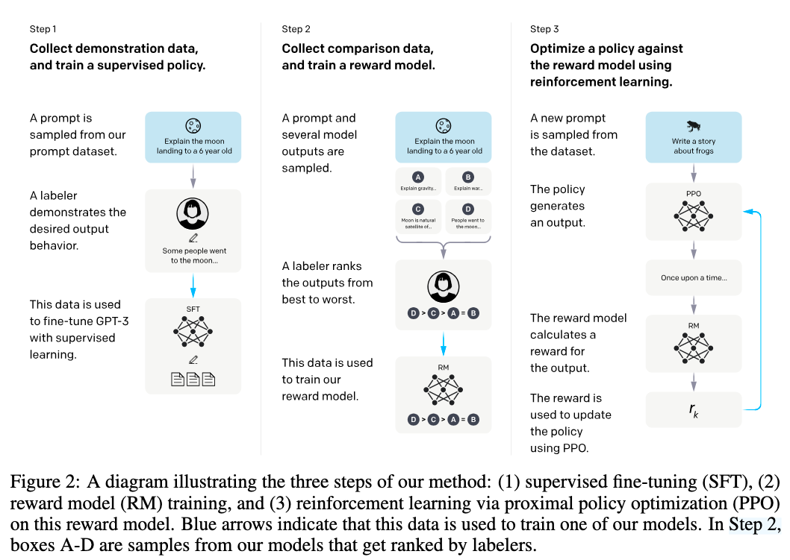

# InstructGPT

# 经典的三阶段 RLHF 范式：

### 输入：

- 一个待对齐的预训练语言模型：GPT-3

- 一个 prompt 分布：主要来自真实 API 用户提交的 prompts，也包括少量 labeler-written prompts

- 一个经过筛选和训练的人类 labeler 团队

### 三阶段

1. 用人类示范数据进行 **Supervised Fine-Tuning（SFT）**

2. 用人类偏好数据训练 **Reward Model（RM）**

3. 用 **PPO** 在奖励模型上继续优化策略模型。

> 论文中的数据被拆成三类：SFT 数据、RM 数据和 PPO 数据。SFT 数据用于训练 supervised policy；RM 数据用于训练奖励模型；PPO 数据本身没有人工标签，只作为 RL 阶段的输入 prompts。
> 
> 

---

# Step 1：Supervised Fine-Tuning（SFT）

SFT 是对预训练 GPT-3 做监督微调。人类 labeler 针对给定 prompt 写出理想回答，模型通过最大化这些示范回答的 likelihood，学习初步的 instruction-following 行为。

> 论文中 SFT 训练了 16 个 epoch，并使用 RM score 在验证集上选择最终模型。
> 
> 

**SFT 模型后续有两个重要用途：**

- 作为 PPO 阶段的初始 policy； 

- 作为 KL penalty 的 reference model，用来防止 PPO 把模型优化得过度偏离原始 SFT 行为。

---

# Step 2：Reward Modeling（RM）

### **本质**：

奖励模型本质上也是由 GPT-3 微调得到的模型

> 本文只使用了 6B 的 RM，因为这样更省算力，并且作者发现 175B 的 RM 训练可能不稳定，不太适合作为 RL 阶段 value function 的初始化来源。
> 
> 

### **输入输出：**

**输入**一个 prompt-response 对 $(x, y)$，**输出**一个标量奖励 $r_\theta(x, y)$

这个标量越高，表示奖励模型预测该回答越可能被人类 labeler 偏好。

### 训练：

#### 训练数据集构建：

对于同一个 prompt，系统会采样多个模型输出。labeler 不只是比较两个回答，而是对 $K=4$ 到 $K=9$ 个回答进行从好到坏的排序。随后，排序结果会被转化为多个两两比较 pairwise comparisons（即共 $\binom{K}{2} = \frac{K(K-1)}{2}$个比较对），用来训练奖励模型。

例如，当$K=4$ 时，对于同一个 prompt，人类 labeler 给出如下排序：

*response A > response C > response B > response D*

则将被转化为如下 $\binom{4}{2} = 6$ 个比较对：

> - *A 优于 C*
> 
> - *A 优于 B*
> 
> - *A 优于 D*
> 
> - *C 优于 B*
> 
> - *C 优于 D*
> 
> - *B 优于 D*
> 
> 

数据集最终是由 **labeler rankings of model outputs** 构成的，也就是说 RM 数据的基本标注单元不是单独的 prompt，而是一个个 ranking set：

> ***“一个 prompt + 多个 responses + 人类排序”***
> 
> 

对于一个 prompt $x_i$，labeler 对同一 prompt 下的 $K_i$ 个 responses 进行排序，得到的比较对集合可以表示为：

$\mathcal{P}_i=\{(w,l): y_{i,w} \succ y_{i,l}\}$，且 $|\mathcal{P}_i| \le \binom{K_i}{2}$（如果有 ties，ties 会被 dropped，无 ties 取等）

其中 $y_{i,w}$ 是人类更喜欢的回答，$y_{i,l}$ 是人类相对不喜欢的回答

所以一个 ranking set 可以写为：

$(x_i, \{y_{i,1}, \dots, y_{i,K_i}\}, \mathcal{P}_i)$

#### 训练目标：

RM 的目标是让 preferred response 的 reward 高于 rejected response 的 reward。

对于从数据集 $D$ 中采用的一个 prompt-response 偏好对 $(x,y_w, y_l)$，其中 $y_w$ 是人类更喜欢的回答，$y_l$ 是人类不喜欢的回答，原文中的**交叉熵损失函数**为：

$\mathcal{L}(\theta) = -\frac{1}{\binom{K}{2}} \mathbb{E}_{(x, y_w, y_l)\sim D} \left[ \log \left( \sigma \left( r_\theta(x, y_w) - r_\theta(x, y_l) \right) \right) \right]$

> 直观理解：如果人类更喜欢 $y_w$，那么模型应该让 $r_\theta(x, y_w)$ 大于 $r_\theta(x, y_l)$。两者 reward 差距越大，RM 越确信 $y_w$ 更好。
> 
> 

根据原文，在训练时，应该是把同一个 prompt 下的所有 comparisons，即一个 ranked set 打包作为一个 batch element 训练。

因此，把数学期望转化为在经验数据集上的求和，更清楚的写法是：

$\mathcal{L}(\theta) = -\frac{1}{N} \sum_{i=1}^{N} \frac{1}{|\mathcal{P}_i|} \sum_{(w,l)\in \mathcal{P}_i} \log \sigma \left( r_\theta(x_i,y_{i,w})- r_\theta(x_i,y_{i,l}) \right)$

其中 $N$ 为 RM 训练集中 ranked set 的数量。

#### 实验细节

在 Appendix 中提到，batch size 设定为 64，根据前面提到的，一个 batch element 是一个 ranked set：$(x_i, \{y_{i,1}, \dots, y_{i,K_i}\}, \mathcal{P}_i)$

因此 loss 的实际计算方式是：

$\mathcal{L}_{batch} = -\frac{1}{B} \sum_{i=1}^{B} \frac{1}{|\mathcal{P}_i|} \sum_{(w,l)\in \mathcal{P}_i} \log \sigma \left( r_\theta(x_i,y_{i,w}) - r_\theta(x_i,y_{i,l}) \right)$

其中 $B=64$。

由于每个 prompt 有 $K=4$ 到 $K=9$ 个 completions，则一个 batch 最多包含：

$\binom{9}{2} = 64 \times 36 = 2304$ 个 pairwise comparisons（K全为9且没有tie）

---

# Step 3：Reinforcement Learning with PPO

PPO 阶段把前面训练好的 **SFT model** 当作初始 policy，然后用 **reward model** 提供的标量奖励继续优化这个 policy。也就是说，模型先根据 prompt 生成 response，RM 再给这个 prompt-response 对打分，PPO 根据这个 reward 更新语言模型参数。

### **Bandit Environment**

这个过程被建模为一个 **bandit environment**：

Bandit environment** **（赌博机环境）可以理解为一种非常简化的强化学习环境，它

**不存在状态信息，没有复杂的多步状态转移，只有动作和奖励**：

模型只做一次决策，环境立刻给一个 reward，然后这个 episode 就结束了。

普通 RL：`state 1 → action 1 → reward 1 → state 2 → action 2 → reward 2 → ...`

bandit：`prompt → model 生成 response → reward model 打分 → 结束`

**训练流程：**

1. Episode 开始 

    1. 从 PPO prompt dataset 中采样一个 prompt； 

    2. 当前 policy model 生成 response； 

    3. RM 对 $(prompt, response)$ 输出一个标量 reward； 

2. Episode 结束；

3. 在 reward 上加入相对于 SFT model 的 **per-token KL penalty**； 

4. 使用 PPO 更新当前 policy； 

### KL penalty：

如果只最大化 RM reward，模型可能会过度优化 reward model，也就是学会生成一些 RM 觉得高分、但人类未必真正喜欢的回答。这就是 reward hacking / over-optimization 的风险。

所以论文在每个 token 上加入相对于 SFT model 的 KL penalty，约束 RL policy 不要偏离 SFT policy 太远。论文明确提到，这个 per-token KL penalty 是为了缓解对 reward model 的过度优化。

带 KL penalty 的 reward 项可以写作：

$\text{reward} = r_\theta(x, y) - \beta \log \frac{\pi_\phi^{RL}(y \mid x)}{\pi^{SFT}(y \mid x)}$

其中 $\beta$ 为 KL penalty 的权重，SFT model 所扮演的角色可以更一般地称为 **Reference model**。

以上论文里写的是  KL penalty 的 sequence-level 形式，但由于语言模型是自回归的，整段 response 的概率等于每个 token 概率的乘积：

$\pi(y \mid x)=\prod_t \pi(y_t \mid x,y_{<t})$

取 log 后就变成每个 token 的 penalty 之和，因此这个 KL penalty 可以展开为 token-level 的求和：

$-\beta \sum_t \log \frac{ \pi_\phi^{RL}(y_t \mid x,y_{<t}) }{ \pi^{SFT}(y_t \mid x,y_{<t}) }$

这就是 per-token KL penalty 的含义：每生成一个 token，都惩罚当前 RL policy 相对于 SFT reference policy 的偏移。

---

# PPO-ptx：混入预训练梯度，减少能力退化

### motivation：

普通 PPO 会让模型更符合人类偏好，但可能带来一个副作用：模型在一些 public NLP datasets 上的性能下降。这个现象可以理解为一种 **alignment tax**：模型变得更 aligned，但部分原有能力被牺牲了。

为缓解这个问题，InstructGPT 论文提出了 **PPO-ptx**。其中 **ptx** 可以理解为 **pretraining mix**：在 PPO 更新时，额外混入来自预训练数据的语言建模梯度。论文指出，这样做是为了修复 public NLP datasets 上的 performance regressions；并且除非特别说明，论文里的 InstructGPT 默认指 PPO-ptx 模型。

PPO-ptx 的目标函数为：

$\text{objective}(\phi) = \mathbb{E}_{(x,y)\sim D_{\pi_\phi^{RL}}} \left[ r_\theta(x,y) - \beta \log \frac{\pi_\phi^{RL}(y \mid x)} {\pi^{SFT}(y \mid x)} \right] + \gamma \mathbb{E}_{x \sim D_{\text{pretrain}}} \left[ \log \pi_\phi^{RL}(x) \right]$

这样一次更新中就包含了两部份梯度：

- PPO gradient：让模型更符合 RM / 人类偏好

- Pretraining gradient：让模型保留原始语言建模能力

合起来就是：`最终更新方向 = PPO 更新方向 + γ × 预训练语言建模更新方向`

> **pretraining mix **的设计目的看起来和 KL penalty 很类似，但论文结果提到：加入 pretraining updates 的 PPO-ptx 可以缓解 public NLP datasets 上的性能退化，比简单增大 KL coefficient 更有效。
> 
> 

## Relations

- uses [[PPO]]
- foundation_for [[GRPO]]
- foundation_for [[RLOO]]
- discussed_in [[用于 LLM 的 RL 实践技术细分]]