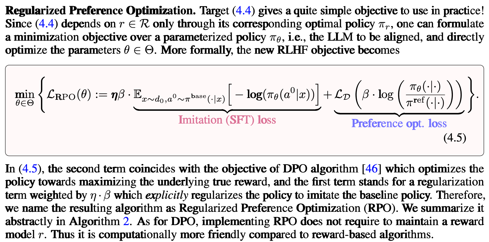

# 用于 LLM 的 RL 实践技术细分

*Liu Z, Liu J, He Y, et al. ****Part I: Tricks or traps? a deep dive into rl for llm reasoning*** 论文阅读笔记

# Baseline Design

## 什么是“baseline”?

在强化学习中，在策略优化方法的选择中，如何平衡 偏差（Bias）和方差（Variance），从而提升策略梯度方法的稳定性和采样效率，是核心之一。

### 这里补充一些详细的 RL 理论推导：[Policy Gradient 推导](https://kmddxkwxdr.feishu.cn/wiki/MxrgwvJqNiAeA1k9uzgcnn1Znie)

REINFORCE 方法是 RL 中最原始的策略梯度方法（[蒙特卡洛方法](https://kmddxkwxdr.feishu.cn/wiki/W1c8wU70YipUPrkm2cAcDpMnnxh#share-IJnTdlbmDotlIixtqtRcHKC7nVc)），它直接使用完整的轨迹回报来估计策略梯度：

$\nabla_\theta J(\theta)=\mathbb{E}\left[\nabla_\theta \log \pi_\theta(a_t|s_t), A_t\right]$

然而，这种方法的方差很高，导致训练过程不稳定。[GAE](https://kmddxkwxdr.feishu.cn/wiki/W1c8wU70YipUPrkm2cAcDpMnnxh#share-QyT6dP5zYove7mxzKs9cASHCn4b) 通过引入 $\lambda$ 来平衡短期与长期误差：

$A_t = \sum_{l=0}^{\infty} (\gamma\lambda)^l \delta_{t+l},\quad \delta_t = r_t + \gamma V_\psi(s_{t+1}) - V_\psi(s_t),$ 

- 当 $\lambda = 1$ 时，GAE 退化为完整的轨迹回报估计，即 REINFORCE 估计器。

- 当 $\lambda=0$ 时，GAE 退化为单步 TD 误差（TD(0)方法）。

也就是说，GAE 通过 $\lambda$ 的加权求和，将 REINFORCE（高方差，低偏差）和 TD(0)（低方差，高偏差）方法结合在一起，实现了一个折中方案。

回归正题，标准的无偏梯度估计为 REINFORCE：

$\nabla_\theta J(\theta) = \mathbb{E}_{y\sim\pi_\theta} \big[ r(x,y)\nabla_\theta \log \pi_\theta(y|x) \big]$

其中y是动作/输出；x是观测/输入。前面提到了，这种方法的代价就是高方差，于是为了降低估计方差，出现了新的[REINFORCE with Baseline](https://medium.com/nerd-for-tech/policy-gradients-reinforce-with-baseline-6c871a3a068) 的技巧，即引入一个 baseline $b(x)$，于是梯度估计变为：

$\nabla_\theta J(\theta) = \mathbb{E}\big[(r(x,y)-b(x)) \nabla_\theta \log\pi_\theta(y|x)\big].$

因为策略的概率分布的总和恒等于 1，即 $\mathbb{E}\big[\nabla_\theta \log\pi_\theta(y|x)\big]=0$（根据 [EGLP Lemma](https://kmddxkwxdr.feishu.cn/wiki/MxrgwvJqNiAeA1k9uzgcnn1Znie#share-TqF3dJHnFoAVJHxUer0cu5h8noe)），且基线$b(x)$与y（样本/输出）无关，故减去 $b(x)$不改变期望（保持无偏），又能显著降低方差。

在传统RL中，常用的基线选择是状态值函数，Sutton 和 Barto 教科书中的伪代码如下：


## “baseline”在 LLM 中

LLM 上的策略梯度有几类额外挑战，使得 baseline 的设计比传统小动作空间 RL 更关键：

1. **极高的方差**：输出序列长、动作空间（词汇表）极大、同一 prompt 下不同样本回报差异大（尤其是稀疏/二元型任务）。

2. **样本相关性与低样本数**：在 RLHF 中，每个输入（prompt）通常只采样很少的预测数（k 很小），如果 baseline 估计差，方差会非常大。

3. **计算/内存开销与实用性**：训练 LLM 用 PPO 需要一个 value network（或 value head）并额外维护训练稳定项与超参，成本高。简单且有效的 baseline 能在不引入额外模型的情况下稳定训练。

4. **reward model 的噪声 / 偏差**：reward model 本身有噪声，若 baseline 估计将噪声引入梯度，会导致学习受损（例如 reward leakage or collapse）。

因此，合适的 baseline 设计直接关系到 RLHF/REINFORCE 在 LLM 上是否“可训练”、收敛速度与稳定性。

## RL for LLM 中的经典基线设计

### （1）全局常数 / 训练集平均

（最简单的设计，最早1992年的文章：Ronald J. Williams. Simple statistical gradient-following algorithms for connectionist reinforcement）

**做法**：用一个全局平均 reward 或运行时的累积平均作为 baseline。

**优点**：极简单；对减少总体方差有帮助。

**缺点**：不能校准到单个 prompt 的难度差异（即不同输入的 reward 分布差异），因此对同一 prompt 下样本差异的方差减少有限。

### （2）每组（每 prompt）内平均（RLOO、GRPO）

**做法**：对同一 prompt 下采样 k 个输出，令基线为该组的平均 reward，即

$b_{\text{group}} = \frac{1}{k}\sum_{j=1}^k r_j,$

或对第 i 个样本使用 leave-one-out，即不使用该样本自身的奖励信息，而是用同一 batch 中其他样本的平均值，这样能更好保持样本与基线之间的独立性，维持估计的无偏性：

$b_{i} = \frac{1}{k-1}\sum_{j\neq i} r_j.$

**直观理由**：同一 prompt 下的输出往往难易相近，用组平均可以消除与 prompt 相关的系统性差异，从而把 baseline 更精确地“对齐”到该 prompt。

**重要事实/等价性**：在多个早期工作中证明（[Kool et al., 2019](https://openreview.net/forum?id=r1lgTGL5DE&utm_source=chatgpt.com)），当 k > 1 时，使用组均值作为 baseline 与使用 leave-one-out 基线在常数因子上是等价/近似的；在 k 较大时，这个常数趋近于 1。也就是说，用组内均值通常“足够好”且实现更简单。 DeepSeekMath 在其 GRPO（Group Relative Policy Optimization）设计中，显式对每个问题（prompt）采样一组输出并用组内平均作为参考/基线以代替单独训练 value head，从而在减少内存与稳定性之间取得折中。该方法在数学推理任务上取得了很好的效果。

### （3）学习型 value baseline（传统 PPO/critic）

**做法**：训练一个 value 网络（或 value head）作为 baseline。PPO 中常用。

**优点**：理论上更灵活，可捕捉长期回报结构（在需要 bootstrap 的场景）。

**缺点**：引入额外模型、更多超参、可能不稳定（在大模型上训练 value head 成本高、且与 policy head 的交互复杂）。部分最近工作指出（GRPO、[Ahmadian et al., 2024](https://aclanthology.org/2024.acl-long.662/)），在 RLHF 场景下这类复杂的引入并非总是必要或优越。


# Clipping Strategies

## 什么是 Clipping？

“**Clipping（裁剪）**”最初来源于 [PPO](https://kmddxkwxdr.feishu.cn/wiki/OIzhwwzgwiqoeLkfh3wck5Dxnah)**，**它的核心思想是：

> 在每次更新策略时，不允许新策略和旧策略的差异（通常以概率比率 ratio 表示）超过一定范围。
> 
> 

在数学上，PPO 定义了一个比率项：$r(\theta_\text{new}) = \frac{\pi_\text{new} (a|s)}{\pi_{\text{old}}(a|s)}$

并在目标函数中引入了一个“裁剪”操作：

$L^{\text{CLIP}}_\theta(\theta_{\text{new}}) = \mathbb{E}_{s \sim d^{\pi}, a\sim \pi}\left[\min\left(r\left(\theta_\text{new}\right)A^{\pi_{\text {old}}}(s, a),\ \text{clip}(r(\theta_\text{new}), 1-\epsilon, 1+\epsilon)A^{\pi_{\text {old}}}(s, a)\right)\right]$

在 RL for LLM 中，这种思想被扩展到更多层面，不仅仅是 **ratio**，还包括对 **rewards**、**advantages** 的裁剪，以增强稳定性。

## 为什么 LLM 中需要 Clipping？

在 LLM 的强化学习优化中，**训练的方差远大于传统RL任务**，主要原因有：

1. **奖励噪声大**：
 来自人类反馈或奖励模型的分数往往波动剧烈（同一回答的得分差异可达几倍），容易造成梯度不稳定。

2. **优势估计（Advantage）偏差高**：
 对 LLM 输出序列计算 advantage 需要对每个token的对数概率求和再加权，其误差积累快。

3. **Ratio 爆炸**：
 由于LLM输出空间巨大，策略分布之间的差异（新旧logits差距）会非常大，造成梯度更新过度或崩溃。

Clipping 策略的作用，就是通过限制更新量或削减极端样本的影响，**在稳定性和探索性之间取得平衡**。

## 几种 Clipping 类别

### （1）对 ratio 做裁剪

这一方法是最核心的。它直接源自PPO，但在LLM中被多次改进，以适配语言生成的特性。其中一个最典型的改进例子就是 Clip Ratio Higher，来自 [DAPO](https://arxiv.org/pdf/2503.14476)。

DAPO 观察到传统 PPO 的裁剪策略会在语言模型中**过度抑制探索**，因为 LLM 的动作空间极其庞大（词表可达50k+），**标准的 clip 范围太小**会让策略难以有效学习新分布。
 因此 DAPO 的核心改进是 **解耦 (Decouple)** 上下裁剪边界，并 **放宽上界**，让策略能在合理范围内进行更大幅度的探索。

- **原始 PPO:** 上下边界由一个超参数 `ε` 控制，对称地设为 `[1-ε, 1+ε]`。

- **Clip Ratio Higher:** 使用两个不同的超参数 `ε_lower` 和 `ε_upper`。他们保持下界 `1-ε_lower` 不变（例如 `ε_lower` 仍为 0.2），但增大了上界，例如将 `ε_upper` 设为 0.28 甚至更高。

- **优点**：避免entropy collapse，促进策略跳出局部最优，提升生成多样性；

- **风险**：若clip放得太宽，会增加梯度震荡，因此通常结合 reward normalization 一起使用。

在DAPO中，尚缺乏对这种方法底层机制的深入分析，以及详细的使用指南

本文提出：
（1）对小模型（4B）`ε_upper`遵循“scaling law”，即设为0.32时，表现会比0.28进一步提升；而对于更大尺寸的模型（8B），0.32不如0.28
（2）Aligned models对于`ε_upper`更敏感，此时用DAPO效果更好，而Base models因为策略相对稳定，对`ε_upper`不太敏感

### （2）对 rewards / advantages 做裁剪

1. **奖励模型输出的尺度不一和极端值：** 在 RLHF (Reinforcement Learning from Human Feedback) 流程中，奖励信号通常来自一个独立训练的奖励模型。这个模型的输出是一个标量，代表对生成文本质量的打分。这个分数的大小和范围可能非常不稳定：

    - **尺度不一：** 对于一个好的回答，奖励模型可能输出 2.5，对于一个绝佳的回答，可能输出 5.0。但对于一个触发了模型特定偏见的、看似完美的回答，它可能会给出一个 +20.0 的极端高分。

    - **高方差：** 这种剧烈波动的奖励信号会直接传递给价值函数（Value Function/Critic）的学习。价值函数的目标是预测未来奖励的总和，如果单步奖励就上蹿下跳，价值函数的学习目标就会非常不稳定，导致其难以收敛，评估出的状态价值 `V(s)` 可信度降低。

2. **稳定价值函数的学习：** 价值函数的稳定性至关重要，因为它直接影响优势函数 `A(s, a)` 的计算 `(A(s,a) = R + γV(s') - V(s))`。一个不稳定的价值函数会产生噪声巨大、方差极高的优势估计，进而污染策略梯度，导致策略（Policy/Actor）的更新朝着错误的方向进行，最终使训练过程发散。

通过将奖励裁剪到一个小范围（例如 `[-5, 5]`），我们牺牲了奖励信号的精确幅度信息，但换来了**价值函数学习的稳定性**。价值模型不再需要去拟合那些极端的、可能是噪声的奖励峰值，只需要关注奖励的“方向”（是正向激励还是负向惩罚）和相对大小，这使得它的学习任务变得简单和稳健。


# Normalization Strategies

## **什么是“Normalization”**

是在强化学习优化过程中，对奖励（rewards）或优势（advantages）等信号进行**线性缩放或平移**的一类技术。
 它的主要目的有两个：

1. **控制梯度的尺度（scale control）**，防止梯度爆炸或过小；

2. **减少样本间的方差（variance reduction）**，让训练更平稳、收敛更快。

在pymarl中，也会见到这样的操作，比如q_learner.py里就有standardise_rewards选项：

```Python
if self.args.standardise_rewards:
    rew_shape = (1,) if self.args.common_reward else (self.n_agents,)
    self.rew_ms = RunningMeanStd(shape=rew_shape, device=device)

if self.args.standardise_rewards:
    self.rew_ms.update(rewards)
    rewards = (rewards - self.rew_ms.mean) / th.sqrt(self.rew_ms.var)
```

其中：

`RunningMeanStd`：是一个维护滑动窗口或指数加权统计的类，用于在训练过程中动态更新均值和方差；

`rew_shape`：决定了标准化是全局统一（单个值）还是每个agent单独维护一个均值与方差。

对于多智能体，`rew_shape` 为 `(n_agents,)` 时可使每个agent在自己的reward分布下学习，不会被其他agent奖励尺度干扰。

## LLM 中的归一化

通过引入一个“基线”（Baseline）并从奖励中减去它，可以在不改变梯度期望（即不影响优化的正确方向）的前提下，大幅降低梯度的方-差。**归一化本质上就是一种系统性地选择和应用基线的方法，其首要目标是让训练过程更稳定、更高效。**

LLM强化学习优化具有独特的噪声来源：

归一化可以理解为一种“平衡器”：它不改变优化方向，但让每一步梯度更新的**步长更可控、更一致**。

## 代表性方法和案例

### （1）组级奖励归一化（Group-level Normalization）

**代表性工作：**[前文](https://kmddxkwxdr.feishu.cn/wiki/QQyewfWeFiCFbIkPkdJc0HBPnTf#share-IksCd9RqHoy2AnxQ56fcyI0xnJC)提到过的 DeepseekMath（GRPO）; [Back to Basics](https://arxiv.org/pdf/2402.14740)

[待阅读文章](https://mp.weixin.qq.com/s?__biz=MzA3MzI4MjgzMw==&mid=2650970328&idx=4&sn=32cd2725e27f2ef944f32137328e11ed&poc_token=HHjI_WijuET1qzowa_NX38SpeMtxr3QV-4-sD8jI)

**思路：**不是在整个batch上归一化，而是在一组相同prompt（或相似prompt）对应的多个样本（response）之间归一化。

**好处：**

- 解决不同prompt难度差异问题；

- 让优化关注“同prompt下哪个回答更好”，而不是跨prompt绝对分值的差异；

- 对强化学习中pairwise比较任务（如DPO、RLAIF）尤其有用。

**DeepseekMath** 就使用了这种方法来提升数学推理题的稳定性，因为题目难度差异极大，若不分组，模型会倾向于“优化简单题”。

**Back to Basics** 提出在REINFORCE-style算法中利用RLOO方法能够取得更好的性能，这也是一种Group-level的思想。

### （2）批次级奖励归一化（Batch-level Reward Normalization）

**代表性工作：**[Reinforce++](https://arxiv.org/abs/2501.03262)

**Diss GRPO：**

（a）估计有偏（见[用于 LLM 的 RL 实践技术细分](https://kmddxkwxdr.feishu.cn/wiki/QQyewfWeFiCFbIkPkdJc0HBPnTf#share-WQ7LdS1jPoDdYbxuj2mcxvRenAe)）

（b）组内样本数少，k通常为4或8，容易出现组内全对全错的情况，此时std趋于0，优势估计爆炸

（c）策略可能会在组内过拟合，损害泛化性

认为在单个prompt内过度优化可能会导致 reward hacking（“奖励投机”，即我们所说的卡bug） 并阻碍泛化，尤其是在 response 多样性较低的情况下。

**思路：**对每个 mini-batch 中的奖励进行归一化：$\hat{r}_i = \frac{r_i - \mu_{\text{batch}}}{\sigma_{\text{batch}} + \epsilon}$

其中 $\mu_{\text{batch}}$、$\sigma_{\text{batch}}$分别是该batch内的奖励均值和标准差。

**目的：**

- 保持每个batch的梯度幅度相似；

- 降低由于奖励尺度变化导致的梯度振荡；

- 提高对奖励模型的鲁棒性（奖励模型可能在不同prompt下偏置严重）。

**优点：**

- 实现简单；

- 能显著提升RLHF稳定性；

- 尤其在使用不同reward model（或prompt分布变化）时效果明显。

### （3）Reward Shift without Standard Deviation（去标准差的奖励平移）

**代表工作：**[Understanding R1-Zero-Like Training: A Critical Perspective](https://arxiv.org/abs/2503.20783)（Dr. GRPO）

这类方法不使用标准差项，仅进行奖励的**均值平移**：$\hat{r}_i = r_i - \mu$

**核心思想：**

- 归一化的真正目的不是缩放奖励，而是消除奖励的**难度偏差（difficulty bias）**；

- 标准差缩放会导致简单任务的奖励变化被放大、困难任务被压缩；

- 在R1-zero类训练中（如直接基于pairwise reward差的优化），这种差异化缩放反而会破坏奖励信号的真实性。

**理解关键点：**
传统“标准化”假设奖励尺度无意义，而“Reward Shift without Std”认为奖励差本身**携带语义**（例如GPT-4判的得分差=答案质量差），所以只去均值、不过度拉伸。

实验结果表明：在奖励分布高度集中的场景下（比如在简单数据集中，模型回答正确率很高），省略优势归一化的标准差可以有效防止异常梯度放大，从而提高模型训练的稳定性和鲁棒性。然而，对于以固有较高奖励方差为特征的任务，任何一种归一化方法通常都足以保持稳定的优化。

**简而言之：奖励分布集中时，标准差缩放带来副作用；反之可以进行标准差缩放。**


### （4）批次/组级结合归一化

本文提出了一种结合了Group-level和Batch-level的归一化方法，能够兼顾Group-level和Batch-level的稳定性。

即：计算Local的平均值（Group-level）和Global的标准差（Batch-level）可以实现更稳健的奖励塑造。

$\hat{r}_i = \frac{r_i - \mu_{\text{group}}}{\sigma_{\text{batch}} + \epsilon}$


# Filtering Strategies

## **什么是“Filtering”**

从根本上说，过滤策略是在计算策略梯度并更新模型参数**之前**，对生成的数据样本进行筛选和剔除的一系列技术。在传统的RL中，我们通常会使用Reply Buffer中的所有样本，或者在策略梯度方法中，我们会使用上一轮策略产生的所有轨迹。

然而，在RL for LLM的背景下，我们发现并非所有生成的“回答”（即轨迹或样本）都对模型的学习有益。

有些样本可能包含很少或没有学习信号，有些可能引入噪声导致训练不稳定，还有些则可能在计算上过于昂贵但收效甚微。因此，过滤策略就像一个数据预处理或“净化”步骤。我们设定一些规则或标准，用以判断一个生成的样本是否“优质”或“信息量充足”，然后只将通过筛选的样本送入优化器进行梯度计算。

## 为什么 LLM 中需要 **Filtering？**

将RL应用于LLM时，主要面临以下几个核心问题，而过滤策略正是为了解决这些问题：

1. **训练效率低下**：LLM的训练成本极高。如果大量的计算资源被浪费在那些几乎不产生有效梯度（即对模型更新没有帮助）的样本上，那么整个训练过程的效率会大打折扣。例如，对于模型已经能100%正确回答的问题，再进行训练就意义不大了。

2. **训练不稳定性**：LLM的参数量巨大，不稳定的梯度信号很容易导致灾难性遗忘或模型性能的剧烈波动。一些“离群”的样本，比如模型表现极差的样本，可能会产生巨大或方向错误的梯度，从而破坏模型的现有能力。

3. **方差过大**：在RL中，梯度的方差是一个老生常谈的问题。在LLM中，由于输出空间极为广阔，这个问题更加突出。过滤掉那些信息量不足或奖励信号模糊的样本，可以有效降低梯度估计的方差，使得学习信号更加清晰，从而加速收敛。

4. **探索与利用的平衡**：过滤策略也可以被看作是一种引导探索方向的手段。通过有选择地关注特定类型的样本（例如，特定难度的样本），我们可以引导模型在一个更有前景、更容易学习的区域进行探索，而不是在过于困难或过于简单的任务上停滞不前。

## 代表性方法和案例

### （1）Overlong Filtering（过长过滤）

在强化学习中，我们通常会设置最大response长度，过长的回答因为不好处理而会被截断。当这种情况发生时，由于模型未能得出最终答案（被截断了），因此该response的奖励一定会是一个低值。然而，有时这种过长的回答是因为模型正在进行有意义的推理，这可能会使模型感到困惑，因为它因高质量的推理而受到了惩罚，从而造成模型的推理能力退化。

由DAPO提出，Overlong Filtering的做法也很简单，即去除这些被截断的过长数据，不使用他们来更新模型，以此避免错误的惩罚。

除了直接过滤，还有一种更柔和的变体叫做 **Overlong Reward Shaping（Soft Overlong Punishment）**，它不会直接丢弃样本，而是对超过长度阈值的部分施加一个逐渐增大的惩罚，这样可以为模型提供更平滑的引导信号，鼓励其生成简洁而完整的回答。


### （2）Clip Mask

Clip Mask主要分为以下的两类，它们完美地诠释了一种在RL for LLM中广泛使用的核心思想：**过滤掉那些“过于简单”或“过于困难”的样本**。这与DAPO框架中的`动态采样（Dynamic Sampling）`技术非常相似。

- **Right Min Clip Mask (过滤“过于简单”的样本)**：

    - **它是什么**：这个策略会过滤掉那些模型已经能完美解决的样本，例如，在一批生成的回答中，所有回答都获得了最高的奖励（reward=1）。

    - **解决的问题**：这些“全对”的样本对于梯度计算的贡献为零。在强化学习中，策略的更新依赖于“优势（Advantage）”，即某个动作比平均水平好多少。如果所有回答都一样好，那么优势就是零，梯度也为零。花时间和算力去处理这些样本，对于模型的提升毫无帮助，纯属浪费。动态地将这些样本从训练批次中移除，可以显著提高训练的“样本效率”（Sample Efficiency），用更少的训练步数达到相同的性能。

- **Error Max Clip Mask (过滤“过于困难”的样本)**：

    - **它是什么**：这个策略会过滤掉模型完全无法解决的样本，例如，所有生成的回答都获得了最低的奖励（reward=0）。

    - **解决的问题**：与“过于简单”的样本类似，这些“全错”的样本同样可能导致梯度为零或接近于零，提供的有效学习信号很弱。更重要的是，强行让模型去学习它完全无法理解的任务，可能会产生非常大的梯度，从而破坏模型的参数，导致训练不稳定。与其在这些“硬骨头”上死磕，不如先让模型专注于那些“跳一跳能够得着”的任务，即奖励介于0和1之间的样本。这些样本提供了最丰富、最有效的学习信号。

这两个“Mask”共同实现了一个目标：将模型的注意力集中在信息量最丰富的“学习区”，即那些模型表现有好有坏、有改进空间的任务上。这不仅加速了收敛，也让整个学习过程更加稳定。

### （3）Difficulty Mask（难度掩码）

这是一个更广义的策略，它**根据预设的难度范围来筛选训练样本**。

在训练开始前，可以对数据集中的问题进行难度分级，或者在训练过程中动态评估任务的难度。`Difficulty Mask`会只允许处于某个特定难度区间的样本参与训练。例如，在训练初期，只使用“简单”和“中等”难度的样本，待模型能力提升后，再逐渐引入“困难”的样本。这实际上是典型的课程学习（Curriculum Learning）思想。让模型从易到难地学习，符合认知规律，可以有效避免模型在训练初期就被高难度任务“劝退”，从而稳定学习进程。

见 DACE：[Know When to Explore: Difficulty-Aware Certainty as a Guide for LLM Reinforcement Learning](https://arxiv.org/abs/2509.00125)


# Loss Aggregation Granularity

## **是什么**

**损失聚合的粒度（Loss Aggregation Granularity）** 这个话题对于熟悉传统强化学习（RL）的研究者来说会非常亲切，因为它直接关系到RL中最核心的问题之一：**信用分配（Credit Assignment）**。

在LLM的上下文中：

- 一个**动作（Action）** 是生成下一个token。

- 一个**轨迹（Trajectory）** 或 **回合（Episode）** 是从给出提示（Prompt）开始，到模型生成一个完整的回答（Response）结束的整个过程。

- **奖励（Reward）** 通常是在整个轨迹结束后，根据生成的完整回答的质量给出的一个标量值（例如，人类的评分，或另一个模型的评分）。

在LLM中，损失聚合粒度的选择，就是回答这样一个问题：在优化过程中，我们如何确定每一个样本（response、sequence）或每一个token对于梯度的贡献？

## 两种最常见的聚合策略

### sequence-level

这是一种相对而言直接和简单的方法。它将整个生成序列（Response）视为一个不可分割的整体。

GRPO采用的就是这种方法，具体而言，它首先对每个样本中所有token的损失进行平均，然后对整个batch中每个response的损失进行平均，从而为每个response分配相同的权重，即：


这种方法隐藏的问题在于：无论其长度如何，每个response都被分配了相同的权重，我们考虑以下的场景：

假设我们的模型正在学习一个数学推理任务，目标是**解方程并给出详细的步骤**。我们有一个包含两个样本（Response）的 mini-batch。

**Prompt (对于两个样本都一样):** "请解方程 `2(x + 3) = 14`，并写出你的推理过程。"

**Response A: 简短且正确**

- **生成内容**: "`2x + 6 = 14`，所以 `2x = 8`，因此 `x = 4`。"

- **长度**: 假设为 **10个 tokens**。

- **质量**: 完全正确，但过程非常简洁。

- **奖励 (Reward)**: `R_A = +1.0`

**Response B: 详细、有启发性且正确**

- **生成内容**: "首先，我们使用分配律将括号展开：`2 * x + 2 * 3 = 14`。计算后得到 `2x + 6 = 14`。接下来，为了分离出含有 `x` 的项，我们将等式两边同时减去 6，得到 `2x = 14 - 6`，也就是 `2x = 8`。最后，我们将等式两边同时除以 2，解得 `x = 4`。"

- **长度**: 假设为 **50个 tokens**。

- **质量**: 不仅正确，而且推理过程非常清晰、详尽，是我们更希望模型学习到的那种高质量回答。

- **奖励 (Reward)**: `R_B = +1.0`

此时，按照GRPO的操作，Response A显然会得到更大的梯度更新，因为他获得了与Response B相同的sequence权重，但使用的token数更少。即**更长回答中每个token对总损失的影响被削弱了**，长此以往，模型会学到一个策略：用**最少的token拿到正奖励是最划算的**。它会倾向于生成像A这样的“极简”回答，而不是像B那样我们真正希望的、详尽的回答**。**

同理，我们再假设两种Response都是错误的，得到的奖励都是 -1，那么Response B的惩罚信号同样会被50个token所稀释。每个犯错的token受到的“批评”会非常微弱，**导致模型很难从长回答的错误中吸取教训**。

### token-level

为了解决以上的问题，DAPO改进了token级别的计算方法，道理也很简单，即直接求和group内所有sample的损失，然后通过整个group的总token数进行归一化计算，从而保证了**不管响应长度如何，每个token的贡献都相等**。


### 比较

结合本论文的实验结果，我们可以总结出两种聚合策略的优缺点以及使用指南：

**Token-level 的优点:**

- **信号强度高，信用分配直接**：每个token的优势信号 `Â` 会被直接、无稀释地用于计算其对总损失的贡献。这解决了“长回答信号稀释”的问题。

- **对基础模型（Base Model）学习高效**：对于一个还在学习基本语法和逻辑的Base Model，这种来自每个token的、强有力的、清晰的反馈至关重要。它能快速纠正局部错误，加速模型收敛。

    - **对应现象**：这解释了为什么在实验中，Token-level方法在Base Model上，无论是在收敛速度、峰值准确率还是鲁棒性上都表现更优。

**缺点:**

- **可能破坏已有的宏观结构**：对于已经学会生成高质量长文本的Aligned Model，这种对每个token的“微观管理”可能是有害的。它可能会为了优化某个词而破坏整个句子的流畅性或逻辑链条。

- **对优势估计的噪声敏感**：由于每个token的信号都被同等重视，价值函数对优势 `Â` 的任何微小预测错误都可能被放大，对已经很稳定的Aligned Model造成不必要的干扰。

    - **对应现象**：这解释了为什么在Aligned Model上，Token-level方法的效果反而会变差（“detrimental”）。它过度的局部优化，干扰了模型已经掌握的、更宝贵的高级生成策略。

**Sequence-level 的优点:**

- **保护回答的整体结构与连贯性**：通过在序列内部进行平均，它实际上是在评估和奖励一个“整体的生成质量”。这种宏观的视角不会轻易因为个别token的微小瑕疵而惩罚一个结构优美的长回答。

- **对对齐模型（Aligned Model）微调更稳定**：对于已经很强大的Aligned Model，这种方法能平滑掉单个token优势估计的噪声，提供一个更稳定、更宏观的学习信号，有助于巩固和保持模型高质量的生成能力。

    - **对应现象**：这解释了为什么在Aligned Model上，Sequence-level方法在收敛速度和最终精度上都反超了Token-level。它更好地“维护”了模型已有的高级能力。

**缺点:**

- **信号稀释与长度偏见**：这是其最本质的缺陷。长回答中，每个token（无论好坏）的信号强度都会被长度所稀释。

- **对基础模型（Base Model）学习低效**：对于性能较差的Base Model，这种被稀释后的“微弱”信号不足以提供有效的学习指引。

    - **对应现象**：这解释了在我们讨论的数学题例子中，该方法会潜在地偏爱简短的正确回答，而对长篇的优质回答奖励不足，对长篇的错误回答惩罚也不足。这也解释了它在Base Model上表现不佳的原因。


# Additional Loss Functions

## 辅助损失函数

在RL中，我们通常有一个主要的目标，比如最大化累积奖励，这个目标会通过一个主要的损失函数（如Policy Gradient或Q-learning的TD-error）来优化。

将RL应用于LLM时，会遇到一些传统RL中不常见或不那么严重的问题：

1. **策略漂移与灾难性遗忘 (Policy Drift & Catastrophic Forgetting)**：LLM的参数量巨大，其行为空间（所有可能的文本序列）也极其广阔。在RL优化过程中，模型为了最大化某个特定任务的奖励，其生成文本的分布可能会迅速地、剧烈地偏离其在预训练和监督微调（SFT）阶段学到的语言知识。

2. **奖励投机与对齐失效 (Reward Hacking & Misalignment)**：奖励模型本身是不完美的，它只是人类偏好的一个代替。LLM可能会发现奖励模型的漏洞并加以利用，生成一些能获得高分但实际上质量很差、无益甚至有害的内容。同时，单纯依赖RL奖励，模型可能会丧失在SFT阶段学到的与人类指令保持一致的泛化能力。

因此，研究者们引入了**辅助损失函数**。你可以把它理解为在主优化目标之外增加的“护栏”或“指导信号”，它们与主损失函数加权求和，共同指导模型的更新。

## LLM 中的主损失函数

**LLM 本质上就是一个策略网络 ****`π_θ(a|s)`**** ，即LLM根据当前文本序列，预测下一个词元的概率分布**

由于LLM的动作空间（整个词汇表，通常有数万个词元）是巨大的离散空间，为每个“动作”计算Q值（如Q-learning所做）是完全不可行的。因此，**RL for LLM 几乎无一例外地采用Policy Gradient类的方法**。目前，业界最主流的算法就是 PPO 或其变种 GRPO 等。PPO的主损失函数是对基础Policy Gradient损失函数的一个改进，旨在解决其训练不稳定的问题，见[PPO](https://kmddxkwxdr.feishu.cn/wiki/OIzhwwzgwiqoeLkfh3wck5Dxnah)，[GRPO](https://kmddxkwxdr.feishu.cn/wiki/ZpA7we2T5ijaQAkjhfRc2KWpnYQ)。

## LLM中两种主要的辅助损失函数

### （1）KL 散度 (KL Divergence)

在强化学习中，KL 散度可以用来衡量当前策略与另一个“参考策略”之间的差异，这与PPO的思想完全相同，即控制策略更新的变化不要过大。事实上我们知道PPO有两个主要的变种：PPO-Clip没有直接使用KL 散度作为损失函数，而是使用Clip间接实现这个目的，而PPO-Penalty则直接将KL 散度作为了一个辅助损失函数：

$L^{\text{CLIP}}_\theta(\theta_{\text{new}}) = \mathbb{E}_{s \sim d^{\pi}, a\sim \pi}\left[\min\left(r\left(\theta_\text{new}\right)A^{\pi_{\text {old}}}(s, a),\ \text{clip}(r(\theta_\text{new}), 1-\epsilon, 1+\epsilon)A^{\pi_{\text {old}}}(s, a)\right)\right]$

$L^{\text{Penalty}}_\theta(\theta_{\text{new}}) = \mathbb{E}_{s \sim d^{\pi}, a\sim \pi}\left[r(\theta_\text{new})A^{\pi_{\text {old}}}(s, a)- \beta \cdot D_{KL} \left( \pi_\text{old}(\cdot|s) \| \pi_\text{new}(\cdot|s) \right)\right]$

在经典的RLHF流程（如[PPO-based RLHF](https://kmddxkwxdr.feishu.cn/wiki/ARXGwkjnWiBIfokxs0gc3LgInRd)）中，我们通常已经有了一个经过监督微调（SFT）的模型。这个SFT模型在语言能力、事实性、遵循指令等方面已经达到了一个相当不错的水平。RL阶段的目标是在此基础上，根据人类偏好（由奖励模型代表）微调模型的**风格、语气、安全性**等，使其与人类价值观**对齐**。

在这种场景下，我们不希望模型变得面目全非，只希望它在原有基础上“变得更好”。KL散度损失可以起到稳定训练的作用，这也是为什么经典的GRPO算法沿袭了PPO-Penalty的思想，并在此基础上做了改进：

$J_{\mathrm{GRPO}}(\theta)=\mathbb{E}_{[q\sim P(Q), \{o_i\}_{i=1}^G\sim \pi_{\theta_\text{old}}(\cdot|q)]}\left[\frac{1}{G}\sum_{i=1}^G\frac{1}{|o_i|}\sum_{t=1}^{|o_i|}\operatorname{clip_{term}}\bigg(\frac{\pi_\theta(o_{i,t}\mid q,o_{i,<t})}{\pi_{\theta_\text{old}}(o_{i,t}\mid q,o_{i,<t})},\hat{A}{i,t}\bigg) - \beta\mathrm{D_{KL}}(\pi_\theta| \pi_{\mathrm{ref}})\right]$

其中，`π_ref`（参考模型）是原始的SFT模型，代表了一个“安全且通用”的文本分布。现在，KL散度损失从PPO中的限制策略每一步的梯度更新幅度，变为了限制当前策略和冻结的参考模型之间的差异。

**简而言之，对于“对齐”任务，我们不希望模型变得面目全非，只希望它在原有基础上“变得更好”。**

进一步的，DAPO提出：在训练“长思维链推理模型 (long-CoT reasoning model)”时，KL散度需要从损失函数中移除，这是因为此时任务目标已经脱离了简单的“对齐”：

- **初始模型能力不足**：初始的SFT模型往往**不具备**强大的、长链条的推理能力。它可能会在复杂问题上很快给出错误的、简短的答案。

- **需要根本性的行为改变**：为了学会长链条推理，模型的生成策略需要发生**较大的变化**。它需要学会规划、分解问题、逐步推导，并生成远比SFT阶段长得多、结构复杂得多的文本。

在这种情况下，如果强行使用KL散度将`π_θ`锚定在那个不具备推理能力的`π_ref`上，就会产生一个悖论：**KL散度损失会惩罚模型为了学习推理而做出的必要改变**。模型每当试图生成一个长而复杂的推理链时，都会因为它与SFT模型的简短回答分布差异过大而受到惩罚。这会严重阻碍甚至完全阻止模型学习到新能力。

除此之外，DAPO另一个重要的创新之处：Clip Ratio Higher，实际上也属于相同的思想，即原本的Clip和Penalty已经成为模型探索和学习新能力的障碍，因此必须被放宽或破除。（移除这些训练的“稳定器”，DAPO也提出了新的方法来维持训练的稳定，比如Dynamic Sampling，这属于前文中的Filtering Strategies）

从另一方面，在早期的、基于学习奖励模型的RLHF中，存在一个严重的问题：

1. **奖励模型是静态的**: 它在RL训练开始前，基于一个固定的SFT模型产生的数据集进行训练。

2. **策略模型是动态的**: 在RL训练过程中，LLM（策略模型）为了最大化奖励，其输出的文本分布会不断变化和“进化”。

3. **漂移产生**: 随着策略模型的进化，它会逐渐生成一些“新奇”的、在奖励模型训练时从未见过的文本（即“分布外”或Out-of-Distribution样本）。

4. **Reward Hacking**: 奖励模型对于这些分布外的样本可能会给出不可靠的、错误的评分。策略模型可能会发现奖励模型的这些“盲点”或“漏洞”，并生成一些能够获得高分但实际上质量很差的文本。这就是所谓的**奖励模型的分布漂移**导致的**Reward Hacking**。

但现在主流的方法已经转向了**“Rule-based Verifier”**，即根据一组预先定义的、客观的规则来判断LLM生成的答案是否正确，并据此给出奖励信号 `r`。相比于静态的数据集奖励模型，规则是稳定，客观和可靠的，已经能够很好地避免分布偏移和reward hacking的问题，因此KL散度也就不再被需要（见[Dr. GRPO](https://arxiv.org/abs/2503.20783)）。移除掉KL散度损失，**不仅有利于模型探索，还节省了****`π_ref`****在训练过程中所需的内存和计算**。

### （2）监督微调损失 (SFT Loss)

这一部分原文给的参考文献（GRPO-LEAD）存疑，没看明白哪用到SFT Loss了，以下是自己调研的理解

SFT损失非常直观，它就是LLM在监督微调阶段使用的标准损失函数——**交叉熵损失**（或者叫负对数似然损失）。具体来说，我们会保留一部分高质量的、由人类编写或筛选的“指令-回答”对（即SFT数据），在RL训练的每一步中，也计算模型在这些“标准答案”上的损失。

如果说KL损失是让模型“不忘本来”，那么SFT损失就是让模型“时习典范”，可以类比于传统RL中的模仿学习（Imitation Learning）。见[RPO](https://proceedings.neurips.cc/paper_files/paper/2024/file/fa69e968b7319fd42524febd41475fb3-Paper-Conference.pdf)：



## Relations

- builds_on [[Policy Gradient 推导]]
- builds_on [[GAE]]
- builds_on [[PPO]]
- relates_to [[GRPO]]
- relates_to [[RLOO]]
- relates_to [[InstructGPT]]