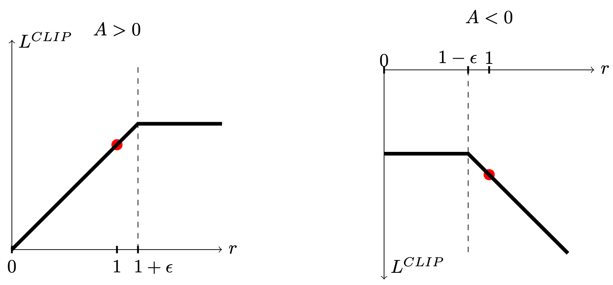
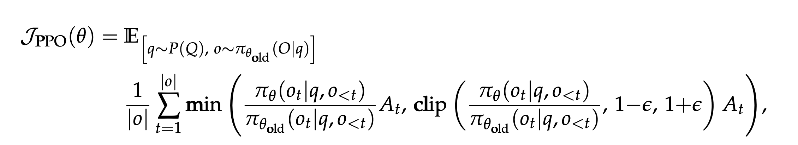

# PPO

**PPO（Proximal Policy Optimization）2017**

PPO 基于 TRPO 的思想进行改进，保留了核心的“替代”优化目标等概念，但是其算法实现更加简单。并且大量的实验结果表明，与 TRPO 相比，PPO 能学习得一样好（甚至更快）

[Engstrom, Logan, et al. "Implementation matters in deep rl: A case study on ppo and trpo." International conference on learning representations. 2019.](https://openreview.net/pdf?id=r1etN1rtPB)

PPO有两种形式：（1）PPO-Clip（2）PPO-Penalty：

**（1）PPO-Clip**

在[TRPO](https://kmddxkwxdr.feishu.cn/wiki/JXM5wdyK6iA4vukYth8cl3TZn9f)中我们用到了新策略与旧策略采取动作a的概率比值，这里我们将其单拎出来定义：

$r(\theta_\text{new}) = \frac{\pi_\text{new} (a|s)}{\pi_{\text{old}}(a|s)}$

这个比值表示了：新策略在状态 s 下采取行动 a 的概率与旧策略相比发生了怎样的变化。

使用这个定义简写“替代”优化目标：

$L_\theta(\theta_{\text{new}}) = \mathbb{E}_{s \sim d^{\pi}, a\sim \pi}\left[r(\theta_\text{new})A^{\pi_{\text {old}}}(s, a)\right]$

而PPO提出对这个比值进行clip操作：

$L^{\text{CLIP}}_\theta(\theta_{\text{new}}) = \mathbb{E}_{s \sim d^{\pi}, a\sim \pi}\left[\min\left(r\left(\theta_\text{new}\right)A^{\pi_{\text {old}}}(s, a),\ \text{clip}(r(\theta_\text{new}), 1-\epsilon, 1+\epsilon)A^{\pi_{\text {old}}}(s, a)\right)\right]$

其中clip(x, l, r) := max(min(x, r), l)，即把x限制在[l, r]内。ϵ是一个超参数，常取0.1、0.2之类的值

外部的min操作，可分为两种情况：

a）A大于0，说明该动作价值高于平均，最大化L会使得r增加，即更倾向于选择该动作

b）A小于0，说明低于平均，最大化L会使r减小，即减少选择该动作

通过clip操作，又可以分为两种情况：

a）r在[1-ϵ, 1+ϵ]范围内，则正常计算

b）若r超出范围，则说明策略发生了较大变化，这是我们不希望看到的，因此此时我们将其限制在[1-ϵ, 1+ϵ]之间，使r不会发生超过这个范围的更新

如下图所示：



这个操作巧妙地防止了新旧策略差异过大，无需再进行KL散度的计算


**（2）PPO-Penalty**

这种变式的思路比较直白，即使用拉格朗日乘数法，直接将KL散度从约束变为惩罚的一项，此时的优化目标为：

$L^{\text{Penalty}}_\theta(\theta_{\text{new}}) = \mathbb{E}_{s \sim d^{\pi}, a\sim \pi}\left[r(\theta_\text{new})A^{\pi_{\text {old}}}(s, a)- \beta \cdot D_{KL} \left( \pi_\text{old}(\cdot|s) \| \pi_\text{new}(\cdot|s) \right)\right]$

其中，KL散度惩罚项的系数β（Lagrange multiplier）是随训练迭代，根据KL散度的大小而动态更新的（KL散度过大，增大β；过小则减小β）

具体而言，PPO原论文中提到的系数更新方法如下：

记当前batch内N个s样本计算得到的KL散度为 KL_{measured}

$\text{KL}_{\text{measured}} = \frac{1}{N} \sum_{i=1}^N D_{\text{KL}}\left( \pi_{\theta_{\text{old}}}(\cdot|s_i) \| \pi_{\theta_{\text{new}}}(\cdot|s_i) \right)$

我们希望这个KL散度不要过大或过小，或者说，我们希望它在某个合理的值周围波动。因此，我们给定这个合理目标值：KL_{target}，基于此，我们每几轮epoch过后，就进行判断：

```Plain Text
if KL_{measured} > KL_{target} * 1.5:
    beta <- beta * 2
elif KL_{measured} < KL_{target} / 1.5: 
    beta <- beta / 2
else:
    keep beta unchanged
```

这些1.5、2之类的缩放值都是实践中可操作的超参数


我认为就这两种变式来说，显然clip变式是更优雅巧妙的

PPO的实践trick参看华腾师兄的笔记[影响PPO性能的trick](https://kmddxkwxdr.feishu.cn/wiki/KPV6wq3FUiMcAQk6RLMcW3GEn2d)


当PPO用于LLM时，优化目标为：



其中 q 和 o 表示采样的问题和输出序列， $o_t$ 为 o 中的第 t 个token

## Relations

- builds_on [[TRPO]]
- uses [[GAE]]
- foundation_for [[GRPO]]
- used_by [[InstructGPT]]
- compared_in [[RLOO]]
- discussed_in [[用于 LLM 的 RL 实践技术细分]]