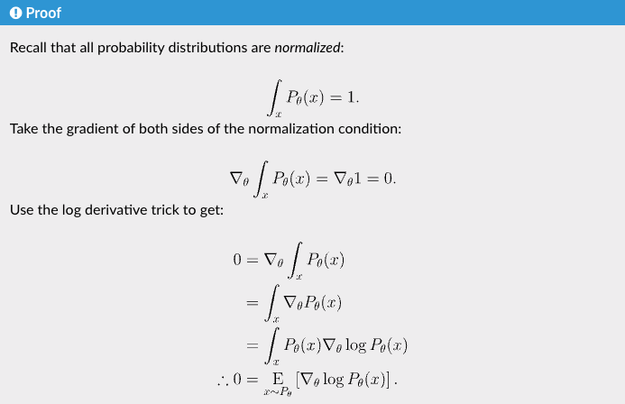

# Policy Gradient 推导

参看：

[https://spinningup.openai.com/en/latest/spinningup/rl_intro3.html#deriving-the-simplest-policy-gradient]()

假设目标策略 $\pi_\theta$ 是一个随机性策略，并且处处可微，其中 $\theta$ 是对应的参数。我们可以用一个线性模型或者神经网络模型来为这样一个策略函数建模，输入某个状态，然后输出一个动作的概率分布。我们的目标是要寻找一个最优策略并最大化这个策略在环境中的期望回报。我们将策略学习的目标函数定义为：

$J(\theta) =\mathbb{E}_{\tau \sim p_\theta(\tau)} \left[ R(\tau) \right]$

其中$\tau = (s_0, a_0, s_1, a_1, \dots, s_T)$表示一条采样的完整轨迹，轨迹的总回报定义为：

$R(\tau)=\sum_{t=0}^{T-1}\gamma^t r_t$

轨迹 $\tau$ 出现的概率由初始状态分布、策略和环境转移概率共同决定：

$p_\theta(\tau)=\rho_0(s_0) \prod_{t=0}^{T-1} \pi_\theta(a_t|s_t) P(s_{t+1}|s_t,a_t)$

为了使用梯度上升更新策略参数，我们需要计算：

$\nabla_\theta J(\theta) = \nabla_\theta \mathbb{E}_{\tau \sim p_\theta(\tau)} [ R(\tau) ]$，

写成积分形式是 $\nabla_\theta J(\theta) = \nabla_\theta\int p_\theta(\tau) R(\tau) d\tau$

其中 $R(\tau)$ 是某条轨迹本身的回报。给定一条轨迹之后，它的奖励序列就确定了，所以 $R(\tau)$ 本身不直接依赖 $\theta$。真正依赖 $\theta$ 的是 $p_\theta(\tau)$，也就是“这条轨迹被当前策略采样出来的概率”。

所以梯度落在 $p_\theta(\tau)$ 上： $\nabla_\theta J(\theta) = \int \nabla_\theta p_\theta(\tau) R(\tau) d\tau$

然而，我们无法直接从 $\nabla_\theta p_\theta(\tau)$ 中采样。为了把梯度改写成可以用当前策略采样估计的**期望形式**，我们引入对数导数技巧（log-derivative trick）： $\nabla_\theta p_\theta(\tau) = p_\theta(\tau) \nabla_\theta \log p_\theta(\tau)$

则原来的积分可以改写为可以采样估计的期望形式： $\int p_\theta(\tau)\nabla_\theta \log p_\theta(\tau)R(\tau)d\tau = \mathbb{E}_{\tau \sim p_\theta(\tau)} \left[ \nabla_\theta \log p_\theta(\tau) R(\tau) \right]$

$\begin{aligned}
\log p_\theta(\tau) &= \log \left( \rho_0(s_0)
\prod_{t=0}^{T-1}
\pi_\theta(a_t|s_t)
P(s_{t+1}|s_t,a_t) \right)
\\ 
&= \log \rho_0(s_0) + \sum_{t=0}^{T-1} \left(\log \pi_\theta(a_t|s_t) + \log P(s_{t+1}|s_t,a_t)\right)
\end{aligned}$

由于初始状态 $s_0$、环境状态转移概率 $P(s_{t+1}|s_t,a_t)$ 都与策略无关，因此可以消掉：

$\begin{aligned}
\nabla_\theta\log p_\theta(\tau) &= \cancel{\nabla_\theta\log \rho_0(s_0)} + \sum_{t=0}^{T-1} \left(\nabla_\theta\log \pi_\theta(a_t|s_t) + \cancel{\nabla_\theta\log P(s_{t+1}|s_t,a_t)}\right)
\\
&= \sum_{t=0}^{T-1}\nabla_\theta\log \pi_\theta(a_t|s_t)
\end{aligned}$

现在它就变成了一个标准期望：

$\nabla_\theta J(\theta) = \mathbb{E}_{\tau \sim p_\theta(\tau)} \left[ \sum_{t=0}^{T-1}\nabla_\theta\log \pi_\theta(a_t|s_t) R(\tau) \right]$

这就是最基础的策略梯度形式，也是 REINFORCE 算法的理论来源。

但根据这个公式，每个动作的对数概率，都会以整条轨迹的总回报 $R(\tau)$ 的比例被强化，这显然是不太符合逻辑的：**行动之前获得的奖励与该行动的好坏无关，只有行动之后获得的奖励才有意义。**

## reward-to-go policy gradient 和 Baseline

### reward-to-go policy gradient

Spinning Up中接下来提出了“reward-to-go policy gradient”，简而言之就是

把原始 policy gradient 里的权重从整条轨迹总回报

$R(\tau)=r_0+r_1+\cdots+r_T$

换成从当前动作之后开始算的 **reward-to-go**

$\hat R_t=r_t+r_{t+1}+\cdots+r_T$

也就是从

$\nabla \log \pi(a_t|s_t)\cdot (r_0+\cdots+r_T)$

变成

$\nabla \log \pi(a_t|s_t)\cdot (r_t+\cdots+r_T)$

这样动作 $a_t$ 就不会受到它发生之前的奖励信号的错误引导。

**从数学上讲，这种做法也有其优点：**

因为它们形如：

$\nabla_\theta \log \pi_\theta(a_t|s_t)\cdot C$

其中 $C$ 是过去奖励，只依赖于 $a_t$ 之前发生的事情。给定当前状态 $s_t$ 和过去历史后， $C$ 对当前动作 $a_t$ 来说是常数。而根据 EGLP lemma：$\mathbb E_{a_t\sim\pi_\theta}[\nabla_\theta \log \pi_\theta(a_t|s_t)] = 0$

$\mathbb E[C\nabla_\theta \log \pi_\theta(a_t|s_t)] = C\cdot 0 = 0$

它们的 **均值为 0 —— 对真实期望梯度没有贡献****。**

同时，他们的 **方差非零**，因为在实际采样里，$\nabla_\theta \log \pi(a_t|s_t)$ 不是每次都等于 0，只是长期平均为 0。乘上过去奖励后，每条 sampled trajectory 都会产生随机波动。

所以这些项的特点是：**期望上没用，但采样时会制造噪声****。**

reward-to-go 的意义就是把这些“均值为零但方差非零”的过去奖励项删掉，使梯度估计更稳定、低方差，需要的轨迹样本更少。

### Baseline

从 reward-to-go policy gradient 就可以初见：EGLP lemma 是一个非常有用的东西。

利用它，我们得到，对任何 **只依赖于 **$s_t$** **的函数 $b(s_t)$，有

$\mathbb E_{a_t\sim\pi_\theta}[\nabla_\theta \log \pi_\theta(a_t|s_t)b(s_t)] = 0$

这样，我们就可以在策略梯度表达式中添加或删除任意数量的此类项，而不会引入偏差（即不会改变其预期结果）。进而，我们提出 baseline 的概念来对此类 $b(s_t)$ 项进行定义。

说 **baseline 只依赖 state** 是准确的，但它是一个**充分条件**，不是最一般条件。

更一般地说：只要 baseline 在当前状态 $s_t$ 给定后 **不依赖当前动作 **$a_t$，它就不会改变 policy gradient 的期望。

它和我们刚刚说的  $C$  本质上是同一类东西：都是乘在 $\nabla_\theta \log \pi_\theta(a_t|s_t)$ 前面的、对当前动作来说“像常数”的项。

一个比 reward-to-go 更好的表示，是把 $R(\tau)$ 替换成从时刻 $t$ 开始的未来折扣回报：

$G_t = \sum_{k=0}^{T-t-1} \gamma^k r_{t+k}$

于是策略梯度可以写成：

$\nabla_\theta J(\theta) = \mathbb{E}_{\tau \sim p_\theta(\tau)} \left[ \sum_{t=0}^{T-1} \nabla_\theta \log \pi_\theta(a_t|s_t) G_t \right]$

这就是常见的 REINFORCE 梯度形式。

---

## 蒙特卡洛采样估计

上面的梯度是对轨迹分布 $p_\theta(\tau)$ 的期望，实际中我们无法解析地计算这个期望，所以只能通过采样估计。假设我们用当前策略 $\pi_\theta$ 与环境交互，采样得到 N 条轨迹：

$\tau^{(1)}, \tau^{(2)}, \dots, \tau^{(N)}$

那么策略梯度可以用样本平均近似：

$\widehat{\nabla_\theta J(\theta)} = \frac{1}{N} \sum_{i=1}^{N} \sum_{t=0}^{T_i-1} \nabla_\theta \log \pi_\theta(a_t^{(i)}|s_t^{(i)}) G_t^{(i)}$

这就是 REINFORCE 的蒙特卡洛估计形式。

---

## Expected Grad-Log-Prob（EGLP） Lemma

期望梯度对数概率引理：

$\mathbb{E}_{x\sim P_\theta}\left[\nabla_\theta \log P_\theta(x)\right]=0$

**核心思想：在一个分布自己采样出来的数据上，log probability 的梯度平均起来为 0。**

在 policy gradient 中，它的主要作用是证明：

> 加入只依赖状态的 baseline 不会改变策略梯度的期望，因此可以安全地用它来降低方差。
> 
> 

---

## 为什么 Policy Gradient 里的 “loss” 不衡量性能？

在 policy gradient 代码中常见的 loss 是：

$L(\theta) = -\frac{1}{N}\sum_i w_i \log \pi_\theta(a_i|s_i)$

其中 $w_i$ 通常是 return 或 advantage。这个 loss 的目的不是衡量策略表现，而是为了让自动微分算出正确的策略梯度：

$-\nabla_\theta L(\theta) = \frac{1}{N}\sum_i w_i \nabla_\theta \log \pi_\theta(a_i|s_i)$

它在 **数据来自当前策略** 且 **梯度在当前参数处计算** 时，才对应 expected return 的上升方向。

真正的性能指标是：

$J(\theta) = \mathbb{E}_{\tau \sim p_\theta(\tau)}[R(\tau)]$

也就是策略和环境交互后的平均回报。

这个 loss 不等于 $-J(\theta)$，也不近似 $-J(\theta)$。它只衡量当前策略对旧 batch 中动作的加权 log probability，而不衡量新策略在环境中的真实表现。

因此，在同一批数据上持续降低这个 loss，可能只是让策略过度拟合旧轨迹里的动作，并不保证 expected return 提高。甚至 loss 越低，策略表现可能越差。

所以在 policy gradient 中：

> **loss 的梯度有意义，loss 的数值本身没有性能意义。训练时应该关注 average return，而不是这个 loss 是否下降。**
> 
> 

## Relations

- foundation_for [[GAE]]
- foundation_for [[RLOO]]
- relates_to [[TRPO]]
- discussed_in [[用于 LLM 的 RL 实践技术细分]]