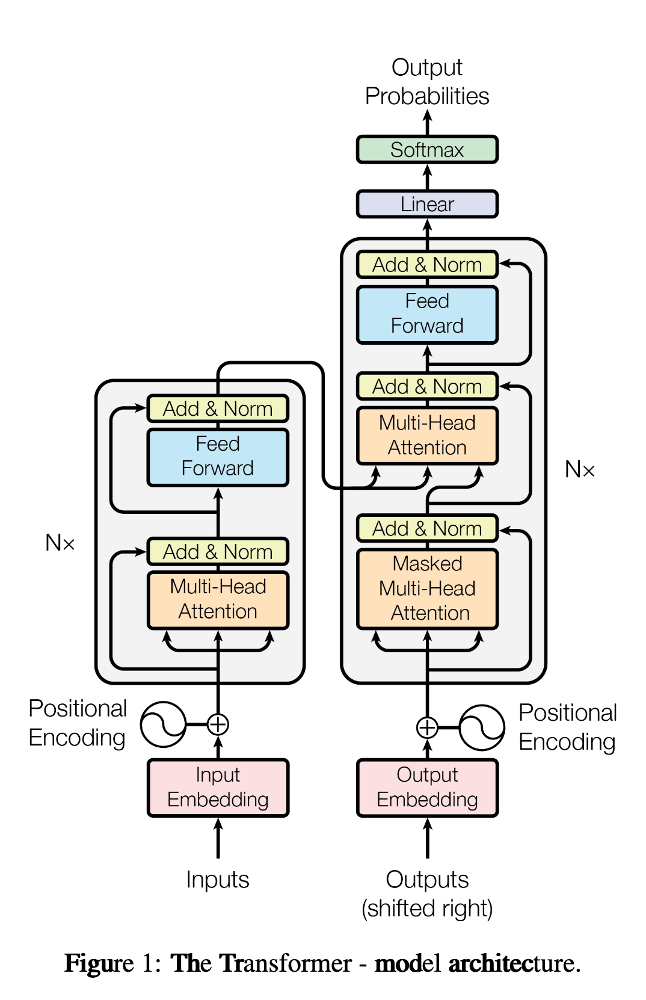

# Transformer 梳理

# 一、 数据输入与预处理 (Input & Positional Encoding)

## **1.1 词嵌入 (Input / Output Embedding):** Token 如何变成连续向量？

自然语言是离散的符号（比如“我”、“爱”、“中”、“国”），神经网络无法直接处理。我们需要将它们映射到高维连续空间中。

- **Tokenization（分词）：** 首先，输入文本会被切分成 Token（可以是词，也可以是子词如 BPE）。每个 Token 会对应词表（Vocabulary）中的一个整数 ID。

- **Embedding Lookup（查表）：** 模型内部维护着一个巨大的权重矩阵，也就是词向量表。它的行数是词表大小 $V$，列数是模型的隐藏层维度 $d_{model}$（论文中 $d_{model} = 512$）。通过 Token ID，模型像查字典一样，抽出对应的那一行，这个 512 维的向量就是该词的语义表示。

- **⚠️ 论文隐藏细节（缩放因子）：** 论文在 3.4 节提到，**在将 Embedding 向量传递给下一步之前，会将其乘以 **$\sqrt{d_{model}}$**（即 **$\sqrt{512} \approx 22.6$**）**。

    - **为什么这么做？** 因为后面的位置编码（PE）的值通常在 $[-1, 1]$ 之间。如果词向量的值太小，与位置编码相加时，语义信息可能会被位置信息“淹没”。乘以 $\sqrt{d_{model}}$ 可以放大词向量的方差，使得语义和位置权重达到平衡。

**假设一个原始输入：**

- **Batch Size (**$B$**) = 2**（同时处理 2 个句子）

- **Sequence Length (**$L$**) = 3**（每个句子包含 3 个 Token，不足的用 PAD 补齐）

- **Vocab Size (**$V$**) = 10000**（词表大小）

- **Model Dimension (**$d_{model}$**) = 512**（词向量维度）

1. 原始输入被 Tokenize 后形成一个 2 x 3 的 ID 矩阵，两行为 `[256, 89, 12]` 和 `[45, 908, 0]` (假设 0 是 PAD)，形状为 $(B, L) = (2, 3)$，数据类型为整型，元素范围是$0～V$

2. 模型拿着 Step 1 中的整数矩阵，去查一个形状为 $(V, d_{model}) = (10000, 512)$ 的 Embedding 权重矩阵。

    - 查表操作后，每个整数都变成了 512 维的浮点向量。

    - **张量形状演变：** `[2, 3]` $\rightarrow$ `[2, 3, 512]`

    - **乘以缩放因子：** 这个 `[2, 3, 512]` 的张量中的每一个元素，都会乘以 $\sqrt{512}$。

    - **Shape:** $(B, L, d_{model}) = (2, 3, 512)$

    - **此时它的物理含义：** 纯粹的词汇语义特征矩阵，记为 $E$。

## 1.2 位置编码 (Positional Encoding)：

RNN 是从左到右按顺序读取单词的，天生自带顺序信息。但 Transformer 的核心——注意力机制是**“全连接”的并发计算**，对它来说，“我打你”和“你打我”的词汇完全一样，如果没有位置信息，模型会把它们当成一回事（这被称为“排列不变性”）。

为了打破这种不变性，Transformer 引入了位置编码（PE）。

- **设计目标：** 

    1. 每个位置有一个唯一的标识。

    2. 不同长度的句子，相对距离的计算方式应该一致。

    3. 能够泛化到比训练集中更长的句子（外推性）。

- **绝对位置编码的“正余弦”魔法：** 论文没有让模型去学习位置，而是硬编码了一组精巧的公式：

    - 偶数维度 (2i): $PE_{(pos, 2i)} = \sin(pos / 10000^{2i/d_{model}})$

    - 奇数维度 (2i+1): $PE_{(pos, 2i+1)} = \cos(pos / 10000^{2i/d_{model}})$

    - *说明：* $pos$ 是 Token 在句子中的物理位置（0, 1, 2...），$i$ 是向量特征的维度索引（$0 \le i < d_{model}/2$）。

- **为什么用正余弦？**

    1. **有界性：** 值域在 $[-1, 1]$ 之间，与 Embedding 相加不会导致数值爆炸。

    2. **表达相对位置：** 论文指出，由于三角函数的和差化积公式，位置 $pos + k$ 的位置编码，可以表示为位置 $pos$ 的位置编码的线性组合。这意味着**模型可以很容易地通过绝对位置学习到相对位置（距离）的信息**。

    3. **多频带：** 随着维度 $i$ 的增大，波长不断变长。低维度（高频）变化快，区分近距离；高维度（低频）变化慢，区分远距离。就像时钟的秒针、分针、时针一样。

**接收形状为 **$(B, L, d_{model}) = (2, 3, 512)$**的词汇语义特征矩阵 **$E$**：**

位置编码通常是预先计算好的（因为公式是固定的）。它只和序列长度 $L$ 有关，和 Batch size 以及具体输入什么词无关。

1. 计算位置 $pos \in [0, 1, 2]$ 的 512 维正余弦向量。

2. **Shape:** $(L, d_{model}) = (3, 512)$

3. 为了能和上面的 $E$ 相加，在深度学习框架（如 PyTorch）中，会利用广播机制（Broadcasting），在最前面增加一个维度。

4. **广播后的 Shape:** $(1, L, d_{model}) = (1, 3, 512)$

5. **此时它的物理含义：** 纯粹的空间位置特征矩阵，记为 $PE$。

## Relations

- relies_on [[梯度计算过程]]