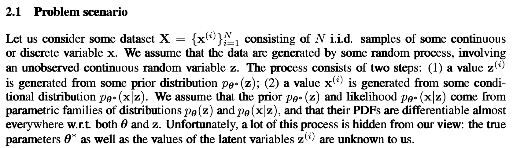

# VAE 的本质和原理

### VAE 是什么时候提出的？

**时间节点：** 2013年底至2014年初。

VAE 的核心思想由两组研究人员几乎同时独立提出，这在科学史上很常见，也侧面印证了该思想在当时技术背景下的必然性：

1. **Diederik P. Kingma 和 Max Welling**：发表了著名的论文 *《Auto-Encoding Variational Bayes》*（2013年发布在 arXiv，ICLR 2014）。这是目前引用率最高的 VAE 开山之作。

2. **Danilo J. Rezende, Shakir Mohamed 和 Daan Wierstra**（来自 DeepMind）：发表了 *《Stochastic Backpropagation and Approximate Inference in Deep Generative Models》*（ICML 2014）。

**时代背景：**
那是深度学习爆发的初期。虽然我们已经有了很强的分类模型（Discriminative Models，如 AlexNet），但在**生成模型（Generative Models）**领域，当时仍然缺乏一种既高效又能处理高维数据（如图片）的通用方法。传统的概率图模型计算极其复杂，难以通过反向传播训练。

---

### VAE 是为了解决什么问题？

VAE 的诞生并不是为了“压缩数据”（那是传统 Autoencoder 的任务），它的核心目标是 **生成（Generation）** 和 **推断（Inference）**。

具体来说，它试图解决以下两个核心痛点：

#### 痛点一：如何让神经网络具备“创造力”？

传统的自编码器（Autoencoder, AE）可以将图片压缩成一个向量（Latent Code），再解压回去。

- **AE 的问题：** 它的潜变量空间（Latent Space）是离散的、不连续的。由于 AE 只是死记硬背地将输入 $X$ 映射到点 $z$，潜空间中充满了“死角”。如果在潜空间随机取一个点进行解码，生成的图像往往是无意义的噪声。

- **VAE 的目标：** 它可以构建一个**平滑、连续且完备**的潜变量空间。你在这个空间里任意漫步（插值），解码出来的结果都是合理且渐变的。

#### 痛点二：不可解的后验概率（Intractable Posterior）

如果我们假设数据是由某个隐变量 $z$ 生成的（即 $P(X|z)$），我们很想知道：给定一张图片 $X$，它对应的隐变量 $z$ 的分布是什么？即后验概率 $P(z|X)$。

根据贝叶斯公式：

$P(z|X) = \frac{P(X|z)P(z)}{P(X)}$

- **问题：** 分母 $P(X)$ 需要对所有可能的 $z$ 进行积分（$\int P(X|z)P(z) dz$ ）。对于高维复杂的神经网络来说，这个积分是**数学上不可解的（Intractable）**。

- **VAE 的目标：** 绕过这个不可解的积分，用一种近似的方法（变分推断）极其聪明地求出这个后验分布。

---

### 它为什么叫“变分自编码器”？

这个名字完美地概括了它的本质，它由两部分组成：**变分（Variational）** + **自编码器（Autoencoder）**。

#### 第一部分：变分（Variational）—— 数学原理

##### 什么是“变分法”？

在普通微积分中，我们寻找的是一个**数值**（变量），使得某个**函数**的值最小或最大。而在变分法中，我们寻找的是一个**函数**，使得某个**泛函（Functional，即以函数为输入的函数）**的值最小或最大。

在现代人工智能和概率统计中，“变分”主要被用来解决复杂的概率计算问题。当我们无法直接计算出真实的、极其复杂的概率分布时，我们会用一个简单的、带有参数的分布去“逼近”它。

这是 VAE 的灵魂所在，即源自统计学中的 **变分推断（Variational Inference, VI）**。

既然真后验 $P(z|X)$ 算不出来，我们就不仅硬算，而是**找一个替身**。

1. 我们找一个已知的好算的分布 $Q(z|X)$（通常假设它是高斯分布）。

2. 我们要调整 $Q$ 的参数，使得 $Q(z|X)$ 无限接近于真实的 $P(z|X)$。

3. **衡量接近程度：** 使用 **KL 散度（KL Divergence）**。

所以，“变分”的意思就是：**将一个复杂的积分问题（求后验概率），转化为一个优化问题（寻找最接近的分布）。**

#### 第二部分：自编码器（Autoencoder）—— 架构实现

这是 VAE 的骨架。为了实现上述的“变分”思想，作者发现可以使用神经网络来参数化这些分布，结构恰好长得像自编码器。

一个自编码器的基本架构为：

- **推断网络（Inference Model / Encoder）：**

    - 输入 $X$，输出不是一个固定的 $z$，而是分布的参数（均值 $\mu$ 和方差 $\sigma^2$）。

    - 这对应了近似后验 $Q(z|X)$。

- **生成网络（Generative Model / Decoder）：**

    - 从分布中采样得到 $z$，输入网络，输出重构的 $\hat{X}$。

    - 这对应了似然 $P(X|z)$。

---

### 深度剖析：VAE 的本质逻辑

为了更透彻地理解，我们可以把 VAE 的工作流程看作是一场**“有约束的编码游戏”**。

#### 对比普通 AE vs. VAE

#### VAE 的核心：两个损失函数的博弈

VAE 的训练目标（Loss Function）推导出来叫 **ELBO (Evidence Lower Bound)**，它实际上包含了两股相互对抗的力量：

1. **重构损失（Reconstruction Loss）：**

    - **目标：** 输出要尽可能像输入。

    - **作用：** 这迫使编码器生成的分布尽可能准确地描述原始数据，让方差 $\sigma$ 趋向于 0（因为方差越小，采样越精准，重构误差越小）。

2. **正则化损失（KL Divergence Loss）：**

    - **目标：** 编码器输出的分布 $Q(z|X)$ 必须尽可能接近标准正态分布 $\mathcal{N}(0, 1)$。

    - **作用：** 这是一股“捣乱”的力量。它强迫潜变量空间具有正态分布的特性（均值为0，方差为1）。这防止了模型仅仅死记硬背数据，并保证了潜空间的平滑性和完备性。

    - **如果不加入此限制：** 只有重构损失，则模型会无限压缩方差直至为0，此时 VAE 就会失去概率生成特性，退化成普通的 AE。

**本质总结：**
VAE 的本质是在**“能够完美复原数据”**和**“潜变量服从标准高斯分布”**之间寻找一个平衡点。

- 如果你想复原得好，分布就得窄（方差小）。

- 如果你想符合标准高斯分布，分布就得宽（方差接近1）。

- VAE 在这种拉锯战中，学到了数据最本质的、鲁棒的特征表示。

### 关键技术：重参数化技巧（Reparameterization Trick）

最后，必须要提这个让 VAE 得以训练的工程奇迹。

VAE 在设计时的逻辑是，先考虑解码器（**生成网络**），即真实数据如何从隐变量中产生（$p_\theta(x|z)$）。当我们的解码器确定了，理论上编码器就也根据贝叶斯公式确定了，即 $p_\theta(z|x) = \frac{p_\theta(x|z)p_\theta(z)}{p_\theta(x)}$。

但是在现实世界中，分母 $p_\theta(x)$ 是一个无法计算的积分，因此，VAE 又搬出一个新的**推断网络**，即 Encoder $q_\phi(z|x)$，用它去近似 $p_\theta(z|x)$。

在 VAE 中，我们需要从编码器输出的分布 $\mathcal{N}(\mu, \sigma^2)$ 中采样一个 $z$ 传给解码器。

VAE 中的数据流：

`Encoder` $\rightarrow$ `得到分布参数` $\rightarrow$ `采样得到 z` $\rightarrow$ `Decoder`$\rightarrow$ `输出 x`

- **问题：** “采样（Sampling）”是一个随机过程，是不可导的。反向传播（Backpropagation）的梯度传到这里就断了，无法训练更新编码器的参数。

- **解决方案：** 重参数化。
作者把随机性“剥离”出来。
$z = \mu + \sigma \odot \epsilon$
其中 $\epsilon \sim \mathcal{N}(0, 1)$ 是从外部采样的噪声。

- 这样一来，$z$ 就变成了关于 $\mu$ 和 $\sigma$ 的**确定性函数**（只不过带了一个随机常数 $\epsilon$）。梯度就可以顺畅地通过 $\mu$ 和 $\sigma$ 传回编码器了。

### 参数族（Parametric Families）

《Auto-Encoding Variational Bayes》原文中的表述如下：

$p_{\theta^*}$：真实世界中的数据分布参数

$p_{\theta}$：一个参数族，即我们构建的神经网络。我们假设真实的$p_{\theta^*}$来自于我们规定的这个参数组$p_{\theta}$，进而能够通过训练，不断调整 $\theta$（也就是神经网络的权重 weights 和偏置 biases），让我们的模型$p_{\theta}$无限接近于真实的$p_{\theta^*}$。

一个参数组就是指一组**形状固定**，但可以通过**有限个参数**来调整具体形态的概率分布集合。

常见的参数族包括：

- **高斯分布族 (Gaussian / Normal Family):**

    - **适用场景：** 连续数据，自然界的噪声、身高、误差分布。

    - **参数 **$\theta$**：** 均值 $\mu$（中心位置），方差 $\sigma^2$（胖瘦程度）。

    - **公式：** $N(x; \mu, \sigma^2)$

- **伯努利分布族 (Bernoulli Family):**

    - **适用场景：** 二元数据（0 或 1，硬币正反，黑白像素）。

    - **参数 **$\theta$**：** $q$（取 1 的概率）。

- **泊松分布族 (Poisson Family):**

    - **适用场景：** 计数数据（单位时间内公交车来的数量、网页点击量）。

    - **参数 **$\theta$**：** $\lambda$（发生率）。

- **贝塔分布族 (Beta Family):**

    - **适用场景：** 概率的概率（取值在 0 到 1 之间，如棒球击球率）。

    - **参数 **$\theta$**：** $\alpha, \beta$（形状参数）。

这里需要注意，原文提到一个重要假设：参数族应当满足“**概率密度函数对于参数 θ 和隐变量 z 几乎处处可微分（differentiable，即可导）**”

这个假设是为了能够使用 **梯度下降（Gradient Descent）** 和 **反向传播（Backpropagation）** 算法来训练神经网络，理由说明如下：

#### 1. 为什么要对参数 $\theta$ 可微？ -> 为了“训练” (Optimization)

这是深度学习的基础，我们希望调整 $\theta$，使得给定 z，Decoder $p_\theta(x|z)$ 模型生成真实数据 x 的概率（Likelihood）最大化。

如果 $p_\theta(x|z)$ 对 $\theta$ 不可微，我们就无法计算梯度，也就不能使用像 SGD 或 Adam 这样的优化器来更新神经网络的权重。

#### 2. 为什么要对隐变量 $z$ 可微？ -> 为了“重参数化技巧” (Reparameterization Trick)

重参数化技巧在前文已经描述过，我们在这里再次梳理一遍 VAE 中的数据流：

`Encoder` $\rightarrow$ `得到分布参数` $\rightarrow$ `重参数化采样得到 z` $\rightarrow$ `Decoder`$\rightarrow$ `输出 x`

为了能够训练前面的 `Encoder`，误差信号必须能够从后面“流”回来。

## Relations

- relies_on [[梯度计算过程]]