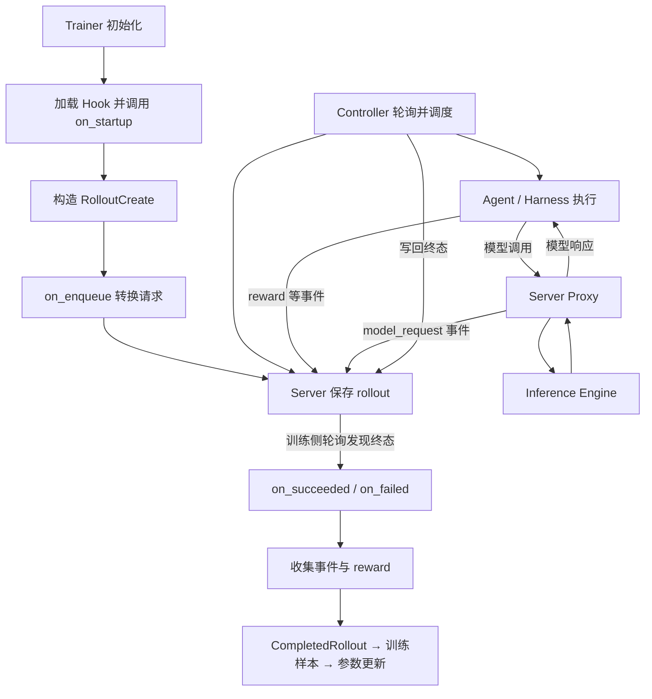

# Hook 机制：从扩展点到 AGL Rollout 与 Agent 运行时控制

## 1. 先建立直觉：谁掌握主流程，谁在指定位置调用扩展逻辑

**Hook 是宿主程序在执行流程中预留的扩展点：运行到指定时机时，宿主主动调用用户提供的函数、方法或脚本。** 用户通常只实现局部逻辑，不需要复制、修改整个主流程。

它不是某种单独的工具或 Python 语法。方法覆盖、函数注册、外部脚本等都可以实现 Hook。真正需要识别的是以下关系：

```text
宿主拥有主流程
    ↓
流程到达扩展点
    ↓
宿主调用已注册或已加载的 Hook，并传入上下文
    ↓
宿主按约定消费返回值、异常或副作用
    ↓
继续、修改或终止后续流程
```

例如，训练框架负责创建 rollout、等待执行、收集轨迹；我只想在创建前修改超时时间，或者完成后统计模型调用次数。如果直接修改框架核心代码，升级和复用都更麻烦。Hook 把“相对稳定的流程骨架”和“随任务变化的逻辑”分开。

**Hook 的能力取决于宿主的调用契约。** 一个名为 `before_xxx` 的方法，只有在调用方真的执行它、读取决策并据此停止操作时，才具备拦截能力。名字本身没有任何强制效果。

## 2. 一个可以独立运行的最小例子

下面是教学代码，不是 AGL 原始接口。它刻意展示“能改输入”“能观察结果”“抛异常时会怎样”。

```python
class Hooks:
    def before_run(self, value):
        return value

    def after_run(self, result):
        pass


class AuditHooks(Hooks):
    def before_run(self, value):
        print("before:", value)
        if value < 0:
            raise ValueError("value must be non-negative")
        return value + 1

    def after_run(self, result):
        print("after:", result)


def run(value, hooks):
    value = hooks.before_run(value)  # 调用方接住返回值，输入修改才生效
    result = value * 2              # 宿主的核心业务
    hooks.after_run(result)         # 返回值没有被使用，通常用于记录等副作用
    return result


print("result:", run(3, AuditHooks()))
```

输出：

```text
before: 3
after: 8
result: 8
```

如果运行 `run(-1, AuditHooks())`，异常会沿调用栈传播，乘法与 `after_run` 都不会执行，因为 `run` 没有捕获异常。由此能看到：

- 普通函数的调用权通常在业务代码手里；这里主流程由 `run` 掌握，具体扩展由用户提供。
- `before_run` 的返回值能改变后续计算，因为调用方显式赋值。
- `after_run` 在计算之后触发；它不能靠“拒绝”让已经完成的计算从未发生。
- Hook 是同步还是异步、失败后继续还是停止，都取决于宿主实现。

## 3. 参考博客时，需要区分一般概念与特定用途

参考文章《钩子(Hook)机制：新兴的Agentic运行时执行层》（安全内参，2026-05-18）主要从 **Agent 运行时安全** 的角度讨论 Hook：在工具执行前插入策略检查，执行后做审计，并强调拦截覆盖、策略保护和绕过风险。[B1]

这是 Hook 的一个重要应用，但不是 Hook 的完整定义。训练数据转换、调试统计、插件扩展也可以使用 Hook。下面的 AGL 实例属于 rollout 生命周期扩展，不应直接理解成工具权限检查。

这篇文章带来的关键阅读问题是：**扩展点在哪里、它接收到什么信息、宿主是否强制执行决策？** 对其中的平台普及程度、研究数字和漏洞案例，本笔记不做复述，也不把它们作为一般原理的证明。

## 4. AGL 实例：先看接口，再顺着调用点理解

以下以本地目录 `/Users/jiajieyin/技术笔记/agent-lightning/` 在 2026-11-11 的源码为准；HEAD 短哈希为 `d3819953`。源码位置见文末 [A1]—[A5]，行号只用于当前快照定位。

### 4.1 四个生命周期方法

`agentlightning/hooks.py` 定义了同步的 `RolloutHooks` 基类。下面省略部分类型注解和文档字符串，保留接口含义：

```python
class RolloutHooks:
    def on_startup(self, store=None):
        pass

    def on_enqueue(self, request):
        return request

    def on_succeeded(self, rollout, events, store):
        pass

    def on_failed(self, rollout, store):
        pass
```

| 方法 | 当前调用时机与输入 | 返回值如何使用 | 典型用途 |
| --- | --- | --- | --- |
| `on_startup` | Trainer 首次加载 Hook 对象后；实际调用没有传 `store` | 不使用返回值 | 初始化统计器、加载配置 |
| `on_enqueue` | 每个 rollout 请求提交 Server 前；输入为 `RolloutCreate` | 替换后续使用的请求 | 修改 input、metadata 或执行配置 |
| `on_succeeded` | 训练侧轮询发现 rollout 为 `SUCCEEDED` 后；传 rollout、按 attempt 分组的原始事件和事件写入接口 | 不使用返回值；可通过 `store.add_event` 追加事件 | 完成后统计、评分或诊断 |
| `on_failed` | 训练侧发现 rollout 为 `FAILED` 后；传 rollout 和事件写入接口 | 不使用返回值 | 记录失败原因、自定义诊断 |

注意三处容易误读的地方：

1. `SUCCEEDED` 是执行生命周期状态，不等于答案正确或 reward 为 1。一个正常退出但回答错误的 Agent 仍可能是 `SUCCEEDED`。
2. `on_succeeded` 由训练侧发现终态后调用，不是 Controller 在状态变化的同一瞬间直接执行回调。
3. `on_failed` 的参数没有 `events`，不能直接照抄成功回调的函数签名。

### 4.2 配置、加载、实例化：Hook 如何接进来

`agentlightning/verl/config.yaml` 默认设置：

```yaml
agentlightning:
  hooks: null
```

配置为 Python 文件路径后，Trainer 的 `_ensure_hooks()` 执行：

```python
self._hooks = load_hooks(hooks_path)
self._hooks.on_startup()
```

`load_hooks()` 会执行该文件的模块代码，通过反射查找 `RolloutHooks` 子类，并以无参数构造函数实例化。当前实现要求发现恰好一个子类：找不到或找到多个都会报错。[A1][A2]

因此：

- 自定义文件保留一个具体 `RolloutHooks` 子类；不要把多个子类一起暴露给加载器。
- 子类通常使用无必填参数的 `__init__()`。
- 这是加载并执行 Python 代码，不是读取纯数据配置；文件应来自可信来源。
- “初始化一次”指当前 Trainer 对象加载并复用该 Hook 实例的正常路径，不是跨进程、重启后全局只执行一次。

Trainer 创建 RolloutManager 时，将这个对象作为 `hooks=` 传进去。Hook 的业务实现就这样进入训练侧主流程，而不需要改 Server 或 Controller。[A2]

### 4.3 入队前：转换请求的 Hook

`AglRolloutManagerBase._create_rollouts()` 的关键顺序是：[A3]

```python
request = RolloutCreate(...)             # 构造请求
if self._hooks is not None:
    request = self._hooks.on_enqueue(request)
rollout_id = uuid.uuid4().hex             # Hook 之后才分配 ID
request = request.model_copy(update={"rollout_id": rollout_id})
# 收集一批请求后 POST /api/rollouts
```

这里可以读出比接口名称更多的信息：

- `on_enqueue` 接收并返回 `RolloutCreate`，必须返回有效请求；忘记 `return` 会使后续代码拿到 `None`。
- 当前调用发生在 ID 分配之前；不要期待在这里读取最终 rollout ID，自定义设置的 ID 也会被后续赋值覆盖。
- GRPO 的同一个输入可以展开多个 rollout，此 Hook 对每个请求分别调用，并非每道题只调用一次。
- 它不只是“打印一下”的通知点：调用方使用返回值，所以能改变实际持久化和执行的请求。

### 4.4 完成后：事件处理 Hook

成功路径可以概括为：[A3]

```text
Trainer / RolloutManager 轮询 Server
    ↓
发现 SUCCEEDED
    ↓
读取原始事件，并按 attempt_id 分组
    ↓
on_succeeded(rollout, events_by_attempt, trace_event_helper)
    ↓
trace_event_helper.flush(manager)
    ↓
重新读取轨迹和 reward，构造 CompletedRollout
```

这里的 `store` 实际上传入 `_TraceEventHelper`，通过 `TraceWriter` 协议暴露 `add_event(...)`。它不是任意数据库连接。`add_event` 先把事件放进内存队列，回调正常返回后，宿主再通过 HTTP 逐条提交给 Server。

因此，追加 `diagnostic_summary` 这类事件是可行的。当前 `_build_completed_rollout()` 会读取事件，并从 reward 事件中提取最终 reward；在成功 Hook 中追加 reward 可能影响训练使用的奖励。这应当作为显式的评分设计，不应在仅做观测时顺便修改。

`events` 参数是回调开始前抓取的快照：新加入队列的事件不会立刻出现在这个字典里。

### 4.5 异常处理：Hook 名字相同，失败语义也未必相同

| 位置 | 当前源码中的行为 | 实际含义 |
| --- | --- | --- |
| 加载、`on_startup` | 该调用处没有就地捕获 | 错误向上层传播 |
| `on_enqueue` | 该调用处没有就地捕获 | 可能打断这批请求的创建 |
| `on_succeeded`、`on_failed` 的回调及 flush | `try/except Exception` 打印错误并继续 | 回调失败不会由此自动把 rollout 改成失败 |

还有两个细节：成功路径读取原始事件发生在上述 `try` 外，因此不能概括成“成功 Hook 的所有错误都会被吞掉”；flush 是逐条写入，也没有在这里提供整批事件的事务回滚。

当前 Hook 是同步方法。不要直接用 `async def` 覆盖后期待宿主自动 `await`；这里调用方没有这样做。耗时 I/O 会阻塞负责执行该回调的训练侧调用流程。

## 5. 一个贴近当前 AGL 接口的自定义示例

以下是按当前源码编写的教学扩展，不是仓库已有的示例。目的：在入队前把超时上限设为 300 秒，完成后追加诊断事件；不改 prompt、模型 token 或 reward。

```python
from agentlightning.hooks import RolloutHooks


class AuditHooks(RolloutHooks):
    def on_startup(self, store=None):
        self.enqueued_count = 0

    def on_enqueue(self, request):
        self.enqueued_count += 1
        config = request.config
        if config is None:
            return request
        config = config.model_copy(update={
            "timeout_seconds": min(config.timeout_seconds, 300)
        })
        return request.model_copy(update={"config": config})

    def on_succeeded(self, rollout, events, store):
        # events 是 dict[attempt_id, list[Event]]，不是单一事件列表。
        for attempt_id, attempt_events in events.items():
            count = sum(
                event.event_type == "model_request"
                for event in attempt_events
            )
            store.add_event(
                rollout_id=rollout.rollout_id,
                attempt_id=attempt_id,
                event_type="diagnostic_summary",
                data={"recorded_model_request_events": count},
            )

    def on_failed(self, rollout, store):
        # 缺少真实 attempt_id 时，避免编造一个正常 attempt。
        attempt_id = rollout.status.last_attempt_id
        if attempt_id is None:
            return
        store.add_event(
            rollout_id=rollout.rollout_id,
            attempt_id=attempt_id,
            event_type="diagnostic_failure",
            data={"error_message": rollout.status.error_message},
        )
```

将文件保存到 Trainer 能访问的位置，例如 `/absolute/path/audit_hooks.py`，在现有训练配置中设置：

```yaml
agentlightning:
  hooks: /absolute/path/audit_hooks.py
```

这里统计的是**抓取到的 `model_request` 事件条数**，不保证等于唯一、成功的模型调用次数：重试或失败请求也可能留下事件。`enqueued_count` 也是当前 Hook 实例的内存计数，不是整个分布式系统的持久统计。

验证状态：最小 Python 示例已执行并验证正常与异常路径；本节 AGL 示例只做了语法检查及接口静态核对，未启动 Trainer、Server 或 GPU 训练，不代表已验证端到端接入。

## 6. Hook 在 AGL 整体数据流中的位置



`on_succeeded` 观察的是一次完整 rollout 的完成；一次 rollout 可以包含多次模型调用和工具调用。**它没有被插在每次工具执行前，所以不能充当每轮工具操作的安全关卡。**

AGL 中记录原始 token IDs 和 logprobs 的主要位置是 Server Proxy 的模型调用记录链路；`RolloutHooks` 不应被理解成负责 token 捕获或 TITO 的机制。相关基础见 [[Agentic RL：Tokenizer 与 TITO 的核心原理]]。

## 7. 其他典型实例：同一个扩展思想，不同契约

### 7.1 Git：提交前检查与提交后通知

Git 官方文档说明：`pre-commit` 在创建提交前运行，脚本非零退出会中止提交；`post-commit` 在提交完成后运行，主要用于通知，不能改变本次提交的结果。[G1]

例如，一个项目可以在 `pre-commit` 中运行格式检查：

```sh
#!/bin/sh
# 教学示例：需要项目已安装并配置 ruff。
exec ruff check .
```

Git 调用脚本，通过进程退出码判断是否继续。这与 AGL 调用 Python 对象方法、消费返回值的形式不同，但都遵循“宿主在预留时机调用扩展”的模式。

`pre-commit` 可被 `git commit --no-verify` 跳过，因此适合本地开发反馈，不能单独当成不可绕过的合规边界。需要强制执行的规则应在受控 CI 或服务端再次检查。[G1]

### 7.2 Agent 工具执行前：策略检查与强制执行

Claude Code 官方 Hook 文档提供 `PreToolUse` 扩展点，其结构化输出可以携带拒绝决策；`PostToolUse` 在执行后触发。[C1]

用平台无关的教学伪代码表达核心逻辑：

```python
def dispatch_tool(call, policy):
    decision = policy.evaluate(call)   # Hook / 策略扩展点
    if not decision.allowed:
        raise PermissionError(decision.reason)
    return execute_tool(call)          # 宿主负责落实拒绝决策
```

这里有三个角色：

- **Hook 扩展点**：提供何时、以什么上下文介入的机会。
- **策略判断**：依据主体、动作、资源和环境做出决策，可用普通代码，也可接策略引擎。
- **执行器**：必须等到决策后再执行，并落实拒绝或修改结果。

如果把检查放在工具执行之后，或者只写日志却仍继续执行，它就不具备事前阻断效果。安全性还取决于所有相关执行路径是否经过检查、策略能否被修改，以及错误与超时后如何处理。Hook 是实现控制的接口，不自动等于完整的安全边界。[B1][C1]

**确定的触发点不代表确定的判断。** Hook 可以运行普通规则，也可以调用模型；一旦用模型评估风险，决策仍包含模型判断的不确定性。不能仅因为“用了 Hook”就把它描述成确定性授权。

## 8. 与相近概念的区别

| 概念 | 侧重点 | 与 Hook 的关系 |
| --- | --- | --- |
| Callback（回调） | 把可调用逻辑交给另一方，之后由其调用 | Hook 常以回调实现；Hook 更强调宿主预留的时机与契约 |
| 事件监听 / Observer | 事件发生后通知订阅者 | 可以实现通知型 Hook；不保证允许修改或阻断原流程 |
| Middleware（中间件） | 包裹请求到响应的调用链，可在前后处理 | 能承载 Hook 类行为，但通常有链式传递或调用下一层的结构 |
| Plugin（插件） | 可加载的功能单元 | 一个插件可注册多个 Hook；插件是组织与分发单位 |
| 类方法覆盖 | 子类提供另一份方法实现 | AGL 以覆盖生命周期方法实现 Hook；不是所有方法覆盖都叫 Hook |
| Monkey patch | 运行时替换现有函数或属性 | 通常没有使用明确预留的扩展契约，升级时更容易依赖内部细节 |
| Webhook | 通过 HTTP 向外部地址发送事件或请求 | 通过网络实现的一类扩展/通知机制；不等于任意本地 Hook |
| React Hooks | React 的特定组件 API 与调用规则 | 共享名称，不能用本文 AGL 生命周期接口推断其用法 |

这些术语有重叠，关键不在于命名争论，而在于调用位置、数据契约与控制权。

## 9. 阅读和设计 Hook 时的检查顺序

遇到 `on_xxx`、`before_xxx`、`after_xxx`，按下面顺序追踪比只看接口定义更有效：

1. **找调用方。** 哪个进程、哪个对象调用？触发的是每个 token、每次模型调用、每个 rollout，还是每个训练 step？
2. **找接入方式。** 通过继承、列表注册、配置路径还是外部脚本？加载几次？对象是否复用？
3. **看输入。** 是可修改对象、拷贝还是事件快照？是否已经有最终 ID？
4. **看返回值。** 有没有赋值、判断或 `await`？没有消费返回值时，返回 `False` 通常不会产生阻断效果。
5. **看异常和超时。** 捕获范围在哪里？失败后继续还是停止？安全策略的错误不能与普通日志失败一概处理。
6. **看副作用。** 只是记录，还是改 input、reward、文件或外部服务？重试是否会重复产生影响？
7. **看覆盖范围。** 是否存在子代理、直接调用、批量路径等绕过扩展点的通道？
8. **验证可观察结果。** 输入真的改变了吗、事件真的写入了吗、原操作真的被阻止了吗？

设计上应让回调尽量短小，区分观测与业务修改；需要外部写入时考虑幂等性。不要无依据地假设“Hook 只触发一次”或“回调失败不会影响主流程”。如果修改 AGL 的 reward，还应同步检查最终奖励如何进入训练样本与优势计算；能看到一条新日志，不等于训练行为已按预期改变。

## Observations

- [fact] 当前本地 AGL 的 RolloutHooks 定义四个同步生命周期方法，由 Trainer 和 RolloutManager 加载及调用。
- [fact] AGL 的 on_enqueue 返回值被用于创建请求，且最终 rollout_id 在该 Hook 返回之后分配。
- [fact] AGL 的成功、失败回调在训练侧发现终态后执行，成功回调能读取按 attempt 分组的事件。
- [insight] 判断 Hook 能力必须查看调用方如何消费返回值、异常和副作用，仅看方法名不足以判断是否能阻断。
- [insight] AGL rollout 生命周期 Hook、Git 提交 Hook、Agent 工具前 Hook 共享扩展点思想，但粒度与失败语义不同。
- [decision] 将观测诊断与 input、reward 等训练行为修改分开；新增扩展先验证触发位置和实际数据流。
- [insight] Hook 提供介入机制；安全边界还要求覆盖完整、决策被执行、策略受保护及明确的失败处理。

## Relations

- relates_to [[Agentic RL：Tokenizer 与 TITO 的核心原理]]
- relates_to [[Agent 规则定义必须可执行和可验收]]

## 参考资料与源码索引

### 文章与官方文档

- [B1] [钩子(Hook)机制：新兴的Agentic运行时执行层](https://www.secrss.com/articles/90433)，安全内参，2026-05-18。参考其运行时执行视角；本文不复述其中未经独立核验的产品覆盖、实验数字和漏洞细节。
- [G1] [Git 官方 githooks 文档](https://git-scm.com/docs/githooks)，重点为 pre-commit 与 post-commit 的触发时机、退出码及绕过说明。查阅日期：2026-11-11。
- [C1] [Claude Code 官方 Hooks reference](https://code.claude.com/docs/en/hooks)，重点为 PreToolUse、PostToolUse 与决策输出契约。查阅日期：2026-11-11；具体字段随版本变化，接入时重新核对。

### 已检查的本地 AGL 源码

- [A1] `/Users/jiajieyin/技术笔记/agent-lightning/agentlightning/hooks.py`：第 15—33 行为 TraceWriter 与生命周期接口，第 36—63 行为动态加载器。
- [A2] `/Users/jiajieyin/技术笔记/agent-lightning/agentlightning/verl/trainer.py`：第 119—127 行为加载与启动 Hook，第 139—153 行为传入 RolloutManager。
- [A3] `/Users/jiajieyin/技术笔记/agent-lightning/agentlightning/verl/agl_rollout_manager.py`：`_TraceEventHelper`、`_create_rollouts`、`_run_succeeded_hook`、`_run_failed_hook`、`_build_completed_rollout` 以及两种终态收集流程。同步收集路径第 569—576 行明确先执行完成 Hook，再组装 CompletedRollout。
- [A4] `/Users/jiajieyin/技术笔记/agent-lightning/agentlightning/verl/config.yaml`：`agentlightning.hooks` 默认值。
- [A5] `/Users/jiajieyin/技术笔记/agent-lightning/agentlightning/schemas.py`：RolloutCreate、RolloutConfig、RolloutMetadata 与生命周期状态的数据定义。

证据范围：AGL 机制结论来自上述本地源码；扩展实现是教学代码；未宣称实际完成 Hook 接入后的 GPU 训练。基本概念与设计建议为结合这些实例的归纳。